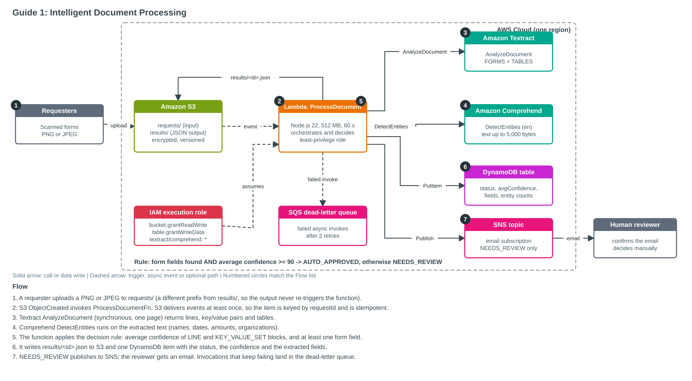

# Guide 1: Intelligent Document Processing

Slide reference: **Case Study 1: Intelligent Document Processing**.

Written for: students who completed the Prerequisites in [README.md](README.md).

## 1. Define the example

**Problem.** Requests arrive as scanned forms (PNG or JPEG). Someone must extract the fields, understand what the form mentions, and decide. We automate the extraction, record the entities each request mentions, and send only doubtful requests to a person. (Classifying requests into types needs a trained Comprehend custom classifier; it is an extension.)

**Data flow (from the slide).** The numbers match the Flow list inside the diagram:



**Services and their role**

| Service | Role |
|---------|------|
| Amazon S3 | Receives the request files under `requests/` |
| AWS Lambda | Orchestrates: calls Textract and Comprehend, applies the decision rule |
| Amazon Textract | Extracts text, forms (key/value pairs) and tables |
| Amazon Comprehend | Detects entities (names, dates, amounts, organizations) |
| Amazon DynamoDB | Stores one item per request with the decision and the extracted fields |
| Amazon SNS | Notifies a reviewer when a request needs a human decision |

**Decision rule (we implement this):**

- If Textract returns at least one form field and the average confidence of the lines and form fields is ≥ 90, status is `AUTO_APPROVED`.
- Otherwise status is `NEEDS_REVIEW` and an SNS message is published.

**Requirements**

- Input: PNG, JPEG (synchronous Textract call, one page per file).
- Output: a DynamoDB item (status, confidence, extracted fields, entity counts) and a JSON result in `results/<name>.json` in the same bucket.
- Failures must not lose a request silently.

### Editing the diagram

Editable draw.io source: [diagrams/01-intelligent-document-processing.drawio](diagrams/01-intelligent-document-processing.drawio). Open it at [app.diagrams.net](https://app.diagrams.net) (File > Open from device) or with the draw.io extension in VS Code. The PNG and the `.drawio` are generated together by [diagrams/build_diagrams.py](diagrams/build_diagrams.py). Dashed arrows are triggers; solid arrows are calls or data writes.

### Design decisions (why this fits the problem)

| Decision | Reason | Trade-off |
|----------|--------|-----------|
| One Lambda orchestrates the steps | The flow is short and linear (a few seconds per page), so a state machine adds cost without benefit | Step Functions becomes better when you add retries per step, long documents or branching |
| Synchronous Textract `AnalyzeDocument` | One page per request returns in seconds | Multi-page PDFs need the asynchronous `StartDocumentAnalysis` API |
| Input and output use different prefixes (`requests/`, `results/`) | The trigger watches only `requests/`, so writing a result never re-invokes the function | None |
| Item keyed by `requestId` | S3 delivers events at least once; a repeated event overwrites the same item | A repeated event can send a second review email |
| Dead-letter queue on the function | Failed asynchronous invocations (after two retries) are kept instead of lost | Someone must watch the queue |
| Human review only below the confidence rule | Cost and reviewer time go to the doubtful cases | The threshold (90) must be tuned with real documents |

## 2. Scaffold the project

```bash
mkdir doc-processing && cd doc-processing
npx cdk init app --language typescript
npm install --save-dev esbuild
npm install @aws-sdk/client-textract @aws-sdk/client-comprehend @aws-sdk/client-dynamodb @aws-sdk/client-sns @aws-sdk/client-s3 @aws-sdk/lib-dynamodb
mkdir lambda
```

`cdk init` creates `bin/doc-processing.ts` and `lib/doc-processing-stack.ts`. The guide uses the stack file `lib/doc-processing-stack.ts`.

The AWS SDK v3 clients ship with the Node.js 20+ Lambda runtime, so the `@aws-sdk/*` packages are bundled only if the runtime lacks them. Keep them in `dependencies` anyway so that the code type-checks locally.

## 3. Write the stack

Replace `lib/doc-processing-stack.ts`:

```typescript
import * as cdk from 'aws-cdk-lib';
import { Construct } from 'constructs';
import * as s3 from 'aws-cdk-lib/aws-s3';
import * as s3n from 'aws-cdk-lib/aws-s3-notifications';
import * as dynamodb from 'aws-cdk-lib/aws-dynamodb';
import * as sns from 'aws-cdk-lib/aws-sns';
import * as subs from 'aws-cdk-lib/aws-sns-subscriptions';
import * as lambda from 'aws-cdk-lib/aws-lambda';
import { NodejsFunction } from 'aws-cdk-lib/aws-lambda-nodejs';
import * as iam from 'aws-cdk-lib/aws-iam';
import * as logs from 'aws-cdk-lib/aws-logs';
import * as sqs from 'aws-cdk-lib/aws-sqs';

export interface DocProcessingStackProps extends cdk.StackProps {
  reviewerEmail: string;
}

export class DocProcessingStack extends cdk.Stack {
  constructor(scope: Construct, id: string, props: DocProcessingStackProps) {
    super(scope, id, props);

    // Requests and results. Encrypted, private, and versioned.
    const bucket = new s3.Bucket(this, 'RequestsBucket', {
      encryption: s3.BucketEncryption.S3_MANAGED,
      blockPublicAccess: s3.BlockPublicAccess.BLOCK_ALL,
      enforceSSL: true,
      versioned: true,
      removalPolicy: cdk.RemovalPolicy.DESTROY,   // lab only
      autoDeleteObjects: true,                    // lab only
    });

    // One item per request.
    const table = new dynamodb.Table(this, 'RequestsTable', {
      partitionKey: { name: 'requestId', type: dynamodb.AttributeType.STRING },
      billingMode: dynamodb.BillingMode.PAY_PER_REQUEST,
      removalPolicy: cdk.RemovalPolicy.DESTROY,   // lab only
    });

    // Human review channel.
    const reviewTopic = new sns.Topic(this, 'ReviewTopic', {
      displayName: 'Document review requests',
    });
    reviewTopic.addSubscription(new subs.EmailSubscription(props.reviewerEmail));

    // Failed asynchronous invocations (after the 2 automatic retries) are kept here.
    const dlq = new sqs.Queue(this, 'ProcessDocumentDlq', {
      encryption: sqs.QueueEncryption.SQS_MANAGED,
      enforceSSL: true,
    });

    const fn = new NodejsFunction(this, 'ProcessDocumentFn', {
      entry: 'lambda/process-document.ts',
      handler: 'handler',
      runtime: lambda.Runtime.NODEJS_22_X,
      memorySize: 512,
      timeout: cdk.Duration.seconds(60),
      logGroup: new logs.LogGroup(this, 'ProcessDocumentLogs', {
        retention: logs.RetentionDays.ONE_WEEK,
        removalPolicy: cdk.RemovalPolicy.DESTROY,   // lab only
      }),
      deadLetterQueue: dlq,
      environment: {
        TABLE_NAME: table.tableName,
        TOPIC_ARN: reviewTopic.topicArn,
        MIN_CONFIDENCE: '90',
      },
      bundling: { minify: true, sourceMap: true },
    });

    // Least privilege: only the actions the function uses.
    bucket.grantReadWrite(fn);
    table.grantWriteData(fn);
    reviewTopic.grantPublish(fn);
    fn.addToRolePolicy(new iam.PolicyStatement({
      actions: ['textract:AnalyzeDocument', 'comprehend:DetectEntities'],
      resources: ['*'], // these APIs do not support resource-level permissions
    }));

    // Trigger the function for every new object under requests/.
    bucket.addEventNotification(
      s3.EventType.OBJECT_CREATED,
      new s3n.LambdaDestination(fn),
      { prefix: 'requests/' },
    );

    new cdk.CfnOutput(this, 'BucketName', { value: bucket.bucketName });
    new cdk.CfnOutput(this, 'TableName', { value: table.tableName });
  }
}
```

Update `bin/doc-processing.ts` so the stack receives the reviewer email:

```typescript
#!/usr/bin/env node
import * as cdk from 'aws-cdk-lib';
import { DocProcessingStack } from '../lib/doc-processing-stack';

const app = new cdk.App();
new DocProcessingStack(app, 'DocProcessingStack', {
  env: { account: process.env.CDK_DEFAULT_ACCOUNT, region: process.env.CDK_DEFAULT_REGION },
  reviewerEmail: app.node.tryGetContext('reviewerEmail') ?? 'you@example.com',
});
```

## 4. Write the Lambda handler

Create `lambda/process-document.ts`:

```typescript
import { S3Event } from 'aws-lambda';
import { S3Client, PutObjectCommand } from '@aws-sdk/client-s3';
import { TextractClient, AnalyzeDocumentCommand, Block } from '@aws-sdk/client-textract';
import { ComprehendClient, DetectEntitiesCommand } from '@aws-sdk/client-comprehend';
import { DynamoDBClient } from '@aws-sdk/client-dynamodb';
import { DynamoDBDocumentClient, PutCommand } from '@aws-sdk/lib-dynamodb';
import { SNSClient, PublishCommand } from '@aws-sdk/client-sns';

const s3 = new S3Client({});
const textract = new TextractClient({});
const comprehend = new ComprehendClient({});
const ddb = DynamoDBDocumentClient.from(new DynamoDBClient({}), {
  marshallOptions: { removeUndefinedValues: true },
});
const sns = new SNSClient({});

const minConfidence = Number(process.env.MIN_CONFIDENCE ?? '90');

// Text of a block: its WORD children joined (a KEY or VALUE block has no text of its own).
const textOf = (block: Block, byId: Map<string, Block>): string =>
  (block.Relationships ?? [])
    .filter(r => r.Type === 'CHILD')
    .flatMap(r => r.Ids ?? [])
    .map(id => byId.get(id))
    .filter((b): b is Block => b?.BlockType === 'WORD')
    .map(b => b.Text ?? '')
    .join(' ');

// Form fields as { "Name": "Maria Perez", "Date": "2025-03-01" }.
const extractFields = (blocks: Block[]): Record<string, string> => {
  const byId = new Map(blocks.filter(b => b.Id).map(b => [b.Id!, b]));
  const fields: Record<string, string> = {};
  for (const key of blocks.filter(b => b.BlockType === 'KEY_VALUE_SET' && b.EntityTypes?.includes('KEY'))) {
    const valueId = (key.Relationships ?? []).find(r => r.Type === 'VALUE')?.Ids?.[0];
    const value = valueId ? byId.get(valueId) : undefined;
    const name = textOf(key, byId).trim();
    if (name) fields[name] = value ? textOf(value, byId).trim() : '';
  }
  return fields;
};

export const handler = async (event: S3Event): Promise<void> => {
  for (const record of event.Records) {
    const bucket = record.s3.bucket.name;
    const key = decodeURIComponent(record.s3.object.key.replace(/\+/g, ' '));
    const requestId = key.split('/').pop() ?? key;

    // 1. Extract text, forms and tables with Textract (synchronous, one page).
    const analysis = await textract.send(new AnalyzeDocumentCommand({
      Document: { S3Object: { Bucket: bucket, Name: key } },
      FeatureTypes: ['FORMS', 'TABLES'],
    }));
    const blocks: Block[] = analysis.Blocks ?? [];
    const lines = blocks.filter(b => b.BlockType === 'LINE').map(b => b.Text ?? '');
    // Only blocks that carry a confidence: a PAGE block has none and must not count as 0.
    const confidences = blocks
      .filter(b => (b.BlockType === 'LINE' || b.BlockType === 'KEY_VALUE_SET') && b.Confidence !== undefined)
      .map(b => b.Confidence as number);
    const fields = extractFields(blocks);
    const avgConfidence = confidences.length
      ? confidences.reduce((a, b) => a + b, 0) / confidences.length
      : 0;

    // 2. Detect entities in the extracted text with Comprehend (max 5000 bytes).
    const text = lines.join('\n').slice(0, 4900);
    const entities = text
      ? (await comprehend.send(new DetectEntitiesCommand({ Text: text, LanguageCode: 'en' })))
          .Entities ?? []
      : [];

    // 3. Decision rule.
    const hasFields = Object.keys(fields).length > 0;
    const status = hasFields && avgConfidence >= minConfidence ? 'AUTO_APPROVED' : 'NEEDS_REVIEW';

    // 4. Store the result as JSON next to the source document.
    const entityCounts: Record<string, number> = {};
    for (const e of entities) entityCounts[e.Type ?? 'OTHER'] = (entityCounts[e.Type ?? 'OTHER'] ?? 0) + 1;
    const result = { requestId, status, avgConfidence, fields, entities, lines };
    await s3.send(new PutObjectCommand({
      Bucket: bucket,
      Key: `results/${requestId}.json`,
      Body: JSON.stringify(result),
      ContentType: 'application/json',
    }));

    // 5. Persist the decision.
    await ddb.send(new PutCommand({
      TableName: process.env.TABLE_NAME,
      Item: { requestId, status, avgConfidence, fields, entityCounts, sourceKey: key, processedAt: new Date().toISOString() },
    }));

    // 6. Send doubtful requests to a person.
    if (status === 'NEEDS_REVIEW') {
      await sns.send(new PublishCommand({
        TopicArn: process.env.TOPIC_ARN,
        Subject: `Review needed: ${requestId}`,
        Message: `Request ${requestId} (${key}) has average confidence ${avgConfidence.toFixed(1)}.`,
      }));
    }
  }
};
```

Install the type package used above: `npm install --save-dev @types/aws-lambda`.

## 5. Deploy

```bash
npm run build                                           # type-check the project
npx cdk synth -c reviewerEmail=you@example.com          # generate the CloudFormation template
npx cdk diff -c reviewerEmail=you@example.com           # review what will change
npx cdk deploy -c reviewerEmail=you@example.com         # deploy
```

Open the email from SNS and click **Confirm subscription**. Without this step you will not receive review messages.

## 6. Test

### 6.1 Test with the AWS console (UI)

1. **CloudFormation** > Stacks > `DocProcessingStack` > **Outputs**. Copy `BucketName` and `TableName`.
2. **S3** > open the bucket > **Create folder** named `requests` > open it > **Upload** a sample PNG. The folder name must be exactly `requests/`, or the trigger does not fire.
3. Wait about 30 seconds. In the bucket, open the `results/` folder and select `req-001.png.json` > **Download** and open it. Check `status` and `avgConfidence`.
4. **DynamoDB** > Tables > `RequestsTable` > **Explore table items**. Confirm one item with `requestId` = `req-001.png`.
5. **Lambda** > Functions > `ProcessDocumentFn` > **Monitor** > **View CloudWatch logs**. Confirm no `ERROR` lines.
6. Upload a blank or blurry image under `requests/`. Confirm the item has status `NEEDS_REVIEW` and that the reviewer email arrives.

Pass criteria: a result JSON exists, the table item exists, and the blurry image produces an email.

### 6.2 Test with the AWS CLI

Use the bucket name from the stack output.

```bash
BUCKET=$(aws cloudformation describe-stacks --stack-name DocProcessingStack \
  --query "Stacks[0].Outputs[?OutputKey=='BucketName'].OutputValue" --output text)

# Upload a sample form (any PNG or JPEG with printed text works).
aws s3 cp ./sample-form.png s3://$BUCKET/requests/req-001.png

# Wait a few seconds, then inspect the result.
aws s3 ls s3://$BUCKET/results/
aws s3 cp s3://$BUCKET/results/req-001.png.json -

TABLE=$(aws cloudformation describe-stacks --stack-name DocProcessingStack \
  --query "Stacks[0].Outputs[?OutputKey=='TableName'].OutputValue" --output text)
aws dynamodb scan --table-name $TABLE
```

Check the logs if nothing appears:

```bash
aws logs tail /aws/lambda/<function-name-from-console> --follow
```

Expected results:

- A JSON file under `results/` with `status`, `avgConfidence`, `fields`, `entities` and `lines`.
- One DynamoDB item with the same `requestId`, including the extracted `fields`.
- A low-quality or blank image produces `NEEDS_REVIEW` and an email.

Note: the S3 key `requests/req-001.png` produces `requestId = req-001.png`, which is the value the table uses.

To exercise the dead-letter queue, temporarily remove the `textract:AnalyzeDocument` permission and upload a file: after the automatic retries the failed event appears in `ProcessDocumentDlq` (SQS console > **Send and receive messages** > **Poll for messages**).

## 7. Clean up

```bash
npx cdk destroy DocProcessingStack
```

The bucket and table have `RemovalPolicy.DESTROY` only because this is a lab. In production, use `RETAIN`.

## What you practiced

- Event-driven architecture: S3 event triggers Lambda.
- Composition of managed AI services (Textract then Comprehend) inside one function.
- A decision rule with a human-in-the-loop fallback.
- Turning Textract's block graph into usable key/value fields.
- Not losing work: idempotent items and a dead-letter queue.
- Least-privilege IAM through CDK grant methods.
