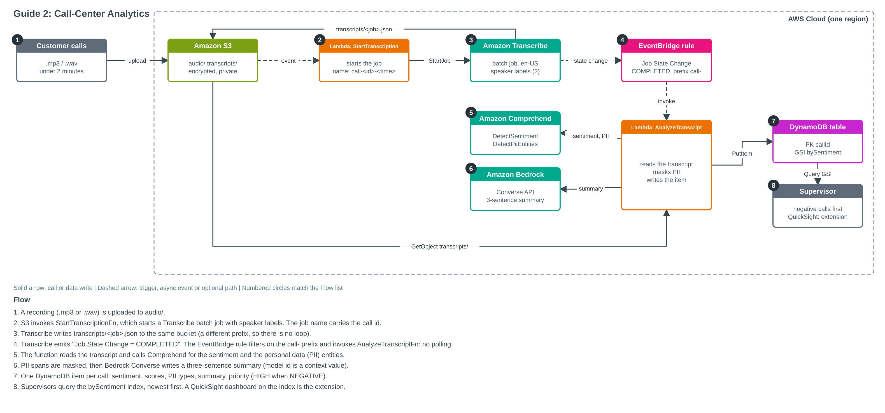

# Guide 2: Call-Center Analytics

Slide reference: **Case Study 2: Call-Center Analytics**.

Written for: students who completed the Prerequisites in [README.md](README.md), including Bedrock model access.

## 1. Define the example

**Problem.** Supervisors cannot listen to every customer call. We transcribe the calls, measure sentiment and detect personal data, generate a short summary with a foundation model, and show the negative calls first.

**Data flow (from the slide).** The numbers match the Flow list inside the diagram:



**Services and their role**

| Service | Role |
|---------|------|
| Amazon S3 | Stores audio under `audio/` and transcripts under `transcripts/` |
| AWS Lambda | Starts transcription, then analyzes the finished transcript |
| Amazon Transcribe | Speech-to-text with speaker labels |
| Amazon EventBridge | Notifies us when a transcription job completes (no polling) |
| Amazon Comprehend | Sentiment (`POSITIVE`, `NEUTRAL`, `NEGATIVE`, `MIXED`) and PII detection |
| Amazon Bedrock | Generates a 3-sentence summary with a foundation model |
| Amazon DynamoDB | One item per call, with a global secondary index (GSI) on sentiment |

**Requirements**

- Input: `.mp3` or `.wav` files uploaded to `audio/`. Use short sample recordings (under 2 minutes) to keep costs low.
- Output per call: sentiment, PII count, summary, and a `priority` flag (`HIGH` when sentiment is `NEGATIVE`).
- Query: list the calls by sentiment, newest first.
- Personal data must not be copied into the summary.

### Editing the diagram

Editable draw.io source: [diagrams/02-call-center-analytics.drawio](diagrams/02-call-center-analytics.drawio). Open it at [app.diagrams.net](https://app.diagrams.net) (File > Open from device) or with the draw.io extension in VS Code. The PNG and the `.drawio` are generated together by [diagrams/build_diagrams.py](diagrams/build_diagrams.py). Dashed arrows are triggers; solid arrows are calls or data writes.

### Design decisions (why this fits the problem)

| Decision | Reason | Trade-off |
|----------|--------|-----------|
| Two Lambdas joined by an EventBridge event | Transcription takes minutes; a single function would wait (and pay) or poll. The completion event starts the second step | Two functions and one rule to maintain |
| The rule filters on the `call-` job-name prefix | Transcribe emits the event for every job in the account; without the filter, unrelated jobs would invoke the analysis | The job name is a contract between both functions |
| PII spans are masked before the text reaches Bedrock | The summary prompt asks the model not to repeat personal data, but masking removes the data before it can be repeated | Comprehend limits one call to 5,000 bytes, so the lab analyzes the first 4,900 characters (enough for calls under 2 minutes) |
| Bedrock Converse API | The same code works with any chat model; only the model id changes | Model ids retire over time; keep the id in context, not in code |
| GSI `bySentiment` (partition `sentiment`, sort `createdAt`) | It answers the supervisor query without scanning | Only four partition values: fine for a lab, a hot partition at high volume (add a date bucket to the key) |

## 2. Scaffold the project

```bash
mkdir call-analytics && cd call-analytics
npx cdk init app --language typescript
npm install --save-dev esbuild @types/aws-lambda
npm install @aws-sdk/client-transcribe @aws-sdk/client-s3 @aws-sdk/client-comprehend \
  @aws-sdk/client-bedrock-runtime @aws-sdk/client-dynamodb @aws-sdk/lib-dynamodb
mkdir lambda
```

`cdk init` names the stack file after the project folder, so it creates `lib/call-analytics-stack.ts`. The next step replaces its content.

## 3. Write the stack

Replace the content of `lib/call-analytics-stack.ts`:

```typescript
import * as cdk from 'aws-cdk-lib';
import { Construct } from 'constructs';
import * as s3 from 'aws-cdk-lib/aws-s3';
import * as s3n from 'aws-cdk-lib/aws-s3-notifications';
import * as dynamodb from 'aws-cdk-lib/aws-dynamodb';
import * as lambda from 'aws-cdk-lib/aws-lambda';
import * as events from 'aws-cdk-lib/aws-events';
import * as targets from 'aws-cdk-lib/aws-events-targets';
import * as iam from 'aws-cdk-lib/aws-iam';
import * as logs from 'aws-cdk-lib/aws-logs';
import { NodejsFunction } from 'aws-cdk-lib/aws-lambda-nodejs';

export class CallAnalyticsStack extends cdk.Stack {
  constructor(scope: Construct, id: string, props?: cdk.StackProps) {
    super(scope, id, props);

    const bucket = new s3.Bucket(this, 'CallsBucket', {
      encryption: s3.BucketEncryption.S3_MANAGED,
      blockPublicAccess: s3.BlockPublicAccess.BLOCK_ALL,
      enforceSSL: true,
      removalPolicy: cdk.RemovalPolicy.DESTROY,   // lab only
      autoDeleteObjects: true,                    // lab only
    });

    const table = new dynamodb.Table(this, 'CallsTable', {
      partitionKey: { name: 'callId', type: dynamodb.AttributeType.STRING },
      billingMode: dynamodb.BillingMode.PAY_PER_REQUEST,
      removalPolicy: cdk.RemovalPolicy.DESTROY,   // lab only
    });
    // Supervisor query: "all NEGATIVE calls, newest first".
    table.addGlobalSecondaryIndex({
      indexName: 'bySentiment',
      partitionKey: { name: 'sentiment', type: dynamodb.AttributeType.STRING },
      sortKey: { name: 'createdAt', type: dynamodb.AttributeType.STRING },
    });

    const env = {
      BUCKET_NAME: bucket.bucketName,
      TABLE_NAME: table.tableName,
      SUMMARY_MODEL_ID: this.node.tryGetContext('summaryModelId') ?? 'anthropic.claude-3-haiku-20240307-v1:0',
    };

    // Lambda 1: starts the Transcribe job when audio arrives.
    const startFn = new NodejsFunction(this, 'StartTranscriptionFn', {
      entry: 'lambda/start-transcription.ts',
      runtime: lambda.Runtime.NODEJS_22_X,
      timeout: cdk.Duration.seconds(30),
      logGroup: new logs.LogGroup(this, 'StartTranscriptionLogs', {
        retention: logs.RetentionDays.ONE_WEEK,
        removalPolicy: cdk.RemovalPolicy.DESTROY,   // lab only
      }),
      environment: env,
    });
    bucket.grantReadWrite(startFn);
    startFn.addToRolePolicy(new iam.PolicyStatement({
      actions: ['transcribe:StartTranscriptionJob'],
      resources: ['*'],
    }));
    bucket.addEventNotification(
      s3.EventType.OBJECT_CREATED,
      new s3n.LambdaDestination(startFn),
      { prefix: 'audio/' },
    );

    // Lambda 2: analyzes the transcript when Transcribe finishes.
    const analyzeFn = new NodejsFunction(this, 'AnalyzeTranscriptFn', {
      entry: 'lambda/analyze-transcript.ts',
      runtime: lambda.Runtime.NODEJS_22_X,
      memorySize: 512,
      timeout: cdk.Duration.seconds(120),
      logGroup: new logs.LogGroup(this, 'AnalyzeTranscriptLogs', {
        retention: logs.RetentionDays.ONE_WEEK,
        removalPolicy: cdk.RemovalPolicy.DESTROY,   // lab only
      }),
      environment: env,
    });
    bucket.grantRead(analyzeFn);
    table.grantWriteData(analyzeFn);
    analyzeFn.addToRolePolicy(new iam.PolicyStatement({
      actions: ['comprehend:DetectSentiment', 'comprehend:DetectPiiEntities'],
      resources: ['*'],
    }));
    // The Converse API is authorized with bedrock:InvokeModel. The second resource covers
    // cross-region inference profile ids (for example "us.anthropic...").
    analyzeFn.addToRolePolicy(new iam.PolicyStatement({
      actions: ['bedrock:InvokeModel'],
      resources: [
        'arn:aws:bedrock:*::foundation-model/*',
        `arn:aws:bedrock:${this.region}:${this.account}:inference-profile/*`,
      ],
    }));

    // Transcribe emits a state-change event for every job in the account:
    // react only to COMPLETED jobs that this application started (name prefix "call-").
    new events.Rule(this, 'TranscriptionCompletedRule', {
      eventPattern: {
        source: ['aws.transcribe'],
        detailType: ['Transcribe Job State Change'],
        detail: {
          TranscriptionJobStatus: ['COMPLETED'],
          TranscriptionJobName: events.Match.prefix('call-'),
        },
      },
      targets: [new targets.LambdaFunction(analyzeFn)],
    });

    new cdk.CfnOutput(this, 'BucketName', { value: bucket.bucketName });
    new cdk.CfnOutput(this, 'TableName', { value: table.tableName });
  }
}
```

Update `bin/call-analytics.ts` so the app name matches the stack class:

```typescript
#!/usr/bin/env node
import * as cdk from 'aws-cdk-lib';
import { CallAnalyticsStack } from '../lib/call-analytics-stack';

const app = new cdk.App();
new CallAnalyticsStack(app, 'CallAnalyticsStack', {
  env: { account: process.env.CDK_DEFAULT_ACCOUNT, region: process.env.CDK_DEFAULT_REGION },
});
```

## 4. Write the Lambda handlers

### `lambda/start-transcription.ts`

```typescript
import { S3Event } from 'aws-lambda';
import { TranscribeClient, StartTranscriptionJobCommand } from '@aws-sdk/client-transcribe';

const transcribe = new TranscribeClient({});

export const handler = async (event: S3Event): Promise<void> => {
  for (const record of event.Records) {
    const key = decodeURIComponent(record.s3.object.key.replace(/\+/g, ' '));
    const callId = key.split('/').pop()!.replace(/\.[^.]+$/, '');
    // Job names allow only letters, digits, '.', '_' and '-'.
    const jobName = `call-${callId.replace(/[^0-9a-zA-Z._-]/g, '-')}-${Date.now()}`;

    await transcribe.send(new StartTranscriptionJobCommand({
      TranscriptionJobName: jobName,
      LanguageCode: 'en-US',
      Media: { MediaFileUri: `s3://${process.env.BUCKET_NAME}/${key}` },
      OutputBucketName: process.env.BUCKET_NAME,
      OutputKey: 'transcripts/',
      Settings: { ShowSpeakerLabels: true, MaxSpeakerLabels: 2 },
    }));
  }
};
```

The transcript is written to `transcripts/<jobName>.json`. The job name is the link between the audio and the transcript, so store the original key in the job name (done above through `callId`).

### `lambda/analyze-transcript.ts`

```typescript
import { EventBridgeEvent } from 'aws-lambda';
import { S3Client, GetObjectCommand } from '@aws-sdk/client-s3';
import { ComprehendClient, DetectSentimentCommand, DetectPiiEntitiesCommand } from '@aws-sdk/client-comprehend';
import { BedrockRuntimeClient, ConverseCommand } from '@aws-sdk/client-bedrock-runtime';
import { DynamoDBClient } from '@aws-sdk/client-dynamodb';
import { DynamoDBDocumentClient, PutCommand } from '@aws-sdk/lib-dynamodb';

const s3 = new S3Client({});
const comprehend = new ComprehendClient({});
const bedrock = new BedrockRuntimeClient({});
const ddb = DynamoDBDocumentClient.from(new DynamoDBClient({}));

type TranscribeDetail = { TranscriptionJobName: string };

// Replace every PII span by its type, e.g. "my card is [CREDIT_DEBIT_NUMBER]". Offsets refer to `text`.
const maskPii = (text: string, entities: { Type?: string; BeginOffset?: number; EndOffset?: number }[]): string =>
  [...entities]
    .sort((a, b) => (b.BeginOffset ?? 0) - (a.BeginOffset ?? 0))   // from the end, so offsets stay valid
    .reduce((t, e) => t.slice(0, e.BeginOffset) + `[${e.Type}]` + t.slice(e.EndOffset), text);

export const handler = async (
  event: EventBridgeEvent<'Transcribe Job State Change', TranscribeDetail>,
): Promise<void> => {
  const jobName = event.detail.TranscriptionJobName;
  const callId = jobName.replace(/^call-/, '').replace(/-\d+$/, '');

  // 1. Read the transcript written by Transcribe.
  const obj = await s3.send(new GetObjectCommand({
    Bucket: process.env.BUCKET_NAME,
    Key: `transcripts/${jobName}.json`,
  }));
  const body = JSON.parse(await obj.Body!.transformToString());
  const text: string = body.results.transcripts[0].transcript;
  const excerpt = text.slice(0, 4900); // Comprehend limit: 5000 bytes per call

  // 2. Sentiment and personal data.
  const sentiment = await comprehend.send(new DetectSentimentCommand({
    Text: excerpt, LanguageCode: 'en',
  }));
  const pii = await comprehend.send(new DetectPiiEntitiesCommand({
    Text: excerpt, LanguageCode: 'en',
  }));

  // 3. Summary with a foundation model on Bedrock. Personal data is masked first.
  const masked = maskPii(excerpt, pii.Entities ?? []);
  const response = await bedrock.send(new ConverseCommand({
    modelId: process.env.SUMMARY_MODEL_ID,
    system: [{ text: 'Summarize customer calls in three sentences. Never repeat personal data.' }],
    messages: [{ role: 'user', content: [{ text: masked }] }],
    inferenceConfig: { maxTokens: 300, temperature: 0 },
  }));
  const summary = response.output?.message?.content?.[0]?.text ?? '';

  // 4. Store one item per call. Negative calls get HIGH priority.
  const label = sentiment.Sentiment ?? 'NEUTRAL';
  await ddb.send(new PutCommand({
    TableName: process.env.TABLE_NAME,
    Item: {
      callId,
      sentiment: label,
      sentimentScore: sentiment.SentimentScore,
      piiCount: pii.Entities?.length ?? 0,
      piiTypes: [...new Set((pii.Entities ?? []).map(e => e.Type))],
      summary,
      priority: label === 'NEGATIVE' ? 'HIGH' : 'NORMAL',
      createdAt: new Date().toISOString(),
    },
  }));
};
```

The Converse API uses one request format for every chat model, so changing the model is a configuration change (`summaryModelId`). Model ids are retired over time: copy a current one from the Bedrock console (Model catalog) and enable it first. A cross-region inference profile id (for example `us.anthropic...`) also works because the policy allows `inference-profile/*`.

The transcript JSON also contains `results.speaker_labels`. This lab does not use it; an extension is to label each sentence "agent" or "customer" before the summary.

## 5. Deploy

```bash
npm run build
npx cdk synth
npx cdk deploy
```

Model access: if the deploy succeeds but the Lambda fails with `AccessDeniedException` on Bedrock, enable the model in the console (see [README.md](README.md)) and set the model ID you enabled:

```bash
npx cdk deploy -c summaryModelId=<model-id-you-enabled>
```

## 6. Test

### 6.1 Test with the AWS console (UI)

1. **CloudFormation** > Stacks > `CallAnalyticsStack` > **Outputs**. Copy `BucketName` and `TableName`.
2. **S3** > the bucket > **Create folder** `audio` > open it > **Upload** a short `.mp3` (under 2 minutes).
3. **Amazon Transcribe** > **Transcription jobs**. Wait until the job whose name starts with `call-` shows status **Completed** (1 to 3 minutes; refresh the page).
4. **S3** > the bucket > `transcripts/` > select the JSON file > **Open** or **Download**. Check that `results.transcripts[0].transcript` contains the spoken text.
5. **DynamoDB** > Tables > `CallsTable` > **Explore table items**. Confirm one item with `sentiment`, `priority`, `summary` and `piiCount`.
6. **DynamoDB** > `CallsTable` > **Indexes** > `bySentiment` > **Query** with partition key `sentiment` = `NEGATIVE`. This is the supervisor view: negative calls first.
7. **EventBridge** > Rules > `TranscriptionCompletedRule` > **Monitoring**. Confirm at least one invocation.
8. **Lambda** > `AnalyzeTranscriptFn` > **Monitor** > **View CloudWatch logs** to check for errors.

Pass criteria: the job completes, the table has one item for the call, and the item's `priority` matches its `sentiment`.

### 6.2 Test with the AWS CLI

```bash
BUCKET=$(aws cloudformation describe-stacks --stack-name CallAnalyticsStack \
  --query "Stacks[0].Outputs[?OutputKey=='BucketName'].OutputValue" --output text)
TABLE=$(aws cloudformation describe-stacks --stack-name CallAnalyticsStack \
  --query "Stacks[0].Outputs[?OutputKey=='TableName'].OutputValue" --output text)

# Upload a short recording (a few seconds of speech in English).
aws s3 cp ./call-001.mp3 s3://$BUCKET/audio/call-001.mp3

# Transcription takes one to three minutes. Check the job status:
aws transcribe list-transcription-jobs --status COMPLETED --max-results 5

# Read the analysis result.
aws dynamodb scan --table-name $TABLE

# Supervisor view: negative calls first, from the GSI.
aws dynamodb query --table-name $TABLE --index-name bySentiment \
  --key-condition-expression "sentiment = :s" \
  --expression-attribute-values '{":s":{"S":"NEGATIVE"}}' --scan-index-forward false
```

Troubleshooting:

- No transcript in `transcripts/`: check the `StartTranscriptionFn` logs. A common cause is a job name with invalid characters.
- The analysis Lambda is not invoked: the EventBridge rule only matches `COMPLETED` jobs whose name starts with `call-`. Check the job status and name in the Transcribe console.
- `AccessDeniedException` from Bedrock: the model is not enabled in your account and region, or the id is wrong.
- A job in `FAILED` state does nothing in this lab. In production, add a second rule for `FAILED` that alerts someone.

## 7. Clean up

```bash
npx cdk destroy CallAnalyticsStack
```

## What you practiced

- Asynchronous processing: a job completes and an event triggers the next step, without polling.
- Chaining AI services (speech to text, sentiment and PII, then a generative summary) and masking personal data before a generative step.
- Modeling access patterns with a DynamoDB GSI.
- Calling a foundation model through Bedrock from Lambda.

Extension: connect the GSI to Amazon QuickSight to build the supervisor dashboard shown on the slide.
