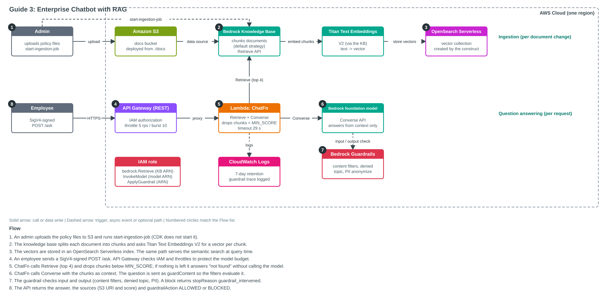

# Guide 3: Enterprise Chatbot with RAG

Slide reference: **Case Study 3: Enterprise Chatbot with RAG**.

Written for: students who completed the Prerequisites in [README.md](README.md), including Bedrock model access.

## 1. Define the example

**Problem.** Employees ask questions about internal policies. The model must answer from the company's own documents, not from its general training, and the output must pass safety rules. No foundation model is trained or fine-tuned.

**Data flow (from the slide).** The numbers match the Flow list inside the diagram:



**Services and their role**

| Service | Role |
|---------|------|
| Amazon S3 | Holds the source documents (PDF, TXT, MD, DOCX) |
| Bedrock Knowledge Base | Splits documents into chunks, creates embeddings, stores them, and retrieves the relevant chunks |
| Amazon OpenSearch Serverless | Vector store used by the knowledge base (created automatically by the construct) |
| Amazon Bedrock (Converse API) | The LLM that writes the answer from the retrieved chunks |
| Amazon Bedrock Guardrails | Filters harmful content and blocks off-topic or unsafe input and output |
| AWS Lambda | Calls Retrieve, then Converse with the guardrail attached |
| Amazon API Gateway | HTTPS entry point for the chatbot front end |
| IAM | The Lambda role gets only the Bedrock actions it needs |

**Requirements**

- Ingest a folder of company documents (we use three short text files).
- Answer only from retrieved context; if nothing relevant is found, say so.
- Block requests and answers that trip the guardrail.
- Show where each answer came from (sources), so an employee can check it.

### Editing the diagram

Editable draw.io source: [diagrams/03-enterprise-chatbot-rag.drawio](diagrams/03-enterprise-chatbot-rag.drawio). Open it at [app.diagrams.net](https://app.diagrams.net) (File > Open from device) or with the draw.io extension in VS Code. The PNG and the `.drawio` are generated together by [diagrams/build_diagrams.py](diagrams/build_diagrams.py). Dashed arrows are triggers; solid arrows are calls or data writes.

### Design decisions (why this fits the problem)

| Decision | Reason | Trade-off |
|----------|--------|-----------|
| RAG instead of fine-tuning | Policies change; re-ingesting a file is cheaper and faster than training, and answers can cite the source | Quality depends on chunking and on the retrieval score |
| Relevance threshold (`MIN_SCORE`) before calling the model | `Retrieve` always returns the best chunks, even when none is relevant. Without a threshold the model would be asked to answer from unrelated text | The value depends on the embedding model: tune it with the scores returned by the API |
| Question sent as `guardContent` | The guardrail filters then evaluate the user's question, not the whole retrieved context | The context itself is not filtered |
| IAM authorization and throttling on the API | Every call costs model tokens; unsigned or abusive traffic must not reach the model | Clients must sign requests (SigV4); use Cognito or an authorizer for a real front end |
| Lambda timeout 29 s | API Gateway cuts the connection at 29 s, so a longer timeout only wastes money | A slow model can exceed it; use streaming for long answers |

## 2. Scaffold the project

```bash
mkdir rag-chatbot && cd rag-chatbot
npx cdk init app --language typescript
npm install --save-dev esbuild @types/aws-lambda
npm install @cdklabs/generative-ai-cdk-constructs @aws-sdk/client-bedrock-agent-runtime @aws-sdk/client-bedrock-runtime
mkdir lambda docs
```

`@cdklabs/generative-ai-cdk-constructs` is a community library that wraps Bedrock Knowledge Bases in CDK constructs (it is not part of `aws-cdk-lib`). Pin its version to the one matching your CDK version, and check the class and property names in its README (the code below uses the `bedrock` namespace exported by the package, with `embeddingsModel`, `BedrockFoundationModel.TITAN_EMBED_TEXT_V2_1024` and `addS3DataSource`). These names have changed between releases.

Create three sample documents:

```bash
cat > docs/vacation-policy.txt <<'EOF'
Employees accrue 1.5 vacation days per month. Unused days can be carried over
up to a maximum of 10 days into the next calendar year.
EOF

cat > docs/remote-work.txt <<'EOF'
Remote work is allowed up to three days per week with manager approval.
Equipment for remote work is provided by the company after a security review.
EOF

cat > docs/expenses.txt <<'EOF'
Travel expenses above 500 USD require prior approval from the finance department.
Receipts must be uploaded within 30 days of the expense.
EOF
```

## 3. Write the stack

Replace `lib/rag-chatbot-stack.ts`:

```typescript
import * as cdk from 'aws-cdk-lib';
import { Construct } from 'constructs';
import * as s3 from 'aws-cdk-lib/aws-s3';
import * as s3deploy from 'aws-cdk-lib/aws-s3-deployment';
import * as lambda from 'aws-cdk-lib/aws-lambda';
import * as apigw from 'aws-cdk-lib/aws-apigateway';
import * as iam from 'aws-cdk-lib/aws-iam';
import * as bedrockCfn from 'aws-cdk-lib/aws-bedrock';
import * as logs from 'aws-cdk-lib/aws-logs';
import { NodejsFunction } from 'aws-cdk-lib/aws-lambda-nodejs';
import { bedrock } from '@cdklabs/generative-ai-cdk-constructs';

export class RagChatbotStack extends cdk.Stack {
  constructor(scope: Construct, id: string, props?: cdk.StackProps) {
    super(scope, id, props);

    // 1. Documents bucket. Files in docs/ are uploaded at deploy time.
    const docsBucket = new s3.Bucket(this, 'DocsBucket', {
      encryption: s3.BucketEncryption.S3_MANAGED,
      blockPublicAccess: s3.BlockPublicAccess.BLOCK_ALL,
      enforceSSL: true,
      removalPolicy: cdk.RemovalPolicy.DESTROY,   // lab only
      autoDeleteObjects: true,                    // lab only
    });
    new s3deploy.BucketDeployment(this, 'DeployDocs', {
      sources: [s3deploy.Source.asset('./docs')],
      destinationBucket: docsBucket,
    });

    // 2. Knowledge base: embeddings + OpenSearch Serverless vector store.
    const kb = new bedrock.VectorKnowledgeBase(this, 'PolicyKnowledgeBase', {
      embeddingsModel: bedrock.BedrockFoundationModel.TITAN_EMBED_TEXT_V2_1024,
      instruction: 'Use this knowledge base to answer questions about company policies.',
    });
    const dataSource = kb.addS3DataSource({
      bucket: docsBucket,
      dataSourceName: 'company-policies',
      chunkingStrategy: bedrock.ChunkingStrategy.DEFAULT,
    });

    // 3. Guardrail: block harmful content in input and output, refuse one topic,
    //    and anonymize contact data that appears in an answer.
    const guardrail = new bedrockCfn.CfnGuardrail(this, 'ChatGuardrail', {
      name: 'rag-chatbot-guardrail',
      blockedInputMessaging: 'This question cannot be processed. Please rephrase it.',
      blockedOutputsMessaging: 'The answer was blocked by the content policy.',
      contentPolicyConfig: {
        filtersConfig: [
          { type: 'HATE', inputStrength: 'HIGH', outputStrength: 'HIGH' },
          { type: 'INSULTS', inputStrength: 'HIGH', outputStrength: 'HIGH' },
          { type: 'SEXUAL', inputStrength: 'HIGH', outputStrength: 'HIGH' },
          { type: 'VIOLENCE', inputStrength: 'HIGH', outputStrength: 'HIGH' },
          { type: 'MISCONDUCT', inputStrength: 'HIGH', outputStrength: 'HIGH' },
          { type: 'PROMPT_ATTACK', inputStrength: 'HIGH', outputStrength: 'NONE' },
        ],
      },
      topicPolicyConfig: {
        topicsConfig: [{
          name: 'ColleagueCompensation',
          definition: 'Questions about the salary or compensation of a specific named person.',
          examples: ['How much does Maria earn?', 'What is the salary of the finance director?'],
          type: 'DENY',
        }],
      },
      sensitiveInformationPolicyConfig: {
        piiEntitiesConfig: [
          { type: 'EMAIL', action: 'ANONYMIZE' },
          { type: 'PHONE', action: 'ANONYMIZE' },
        ],
      },
    });

    // 4. Chat Lambda: retrieve from the knowledge base, then answer with the guardrail.
    const modelId = this.node.tryGetContext('modelId') ?? 'anthropic.claude-3-haiku-20240307-v1:0';
    const chatFn = new NodejsFunction(this, 'ChatFn', {
      entry: 'lambda/chat.ts',
      runtime: lambda.Runtime.NODEJS_22_X,
      memorySize: 512,
      timeout: cdk.Duration.seconds(29),   // API Gateway stops waiting at 29 s
      logGroup: new logs.LogGroup(this, 'ChatLogs', {
        retention: logs.RetentionDays.ONE_WEEK,
        removalPolicy: cdk.RemovalPolicy.DESTROY,   // lab only
      }),
      environment: {
        KNOWLEDGE_BASE_ID: kb.knowledgeBaseId,
        MIN_SCORE: '0.35',   // tune it with the scores returned in the response
        MODEL_ID: modelId,
        GUARDRAIL_ID: guardrail.attrGuardrailId,
        GUARDRAIL_VERSION: 'DRAFT',
      },
    });
    chatFn.addToRolePolicy(new iam.PolicyStatement({
      actions: ['bedrock:Retrieve'],
      resources: [kb.knowledgeBaseArn],
    }));
    // Converse is authorized with bedrock:InvokeModel. The inference-profile ARN covers ids such as "us.anthropic...".
    chatFn.addToRolePolicy(new iam.PolicyStatement({
      actions: ['bedrock:InvokeModel'],
      resources: [
        'arn:aws:bedrock:*::foundation-model/*',
        `arn:aws:bedrock:${this.region}:${this.account}:inference-profile/*`,
      ],
    }));
    // Converse with guardrailConfig needs this permission on the guardrail.
    chatFn.addToRolePolicy(new iam.PolicyStatement({
      actions: ['bedrock:ApplyGuardrail'],
      resources: [guardrail.attrGuardrailArn],
    }));

    // 5. HTTPS API in front of the Lambda. IAM authorization: only signed requests.
    const api = new apigw.LambdaRestApi(this, 'ChatApi', {
      handler: chatFn,
      proxy: false,
      defaultMethodOptions: { authorizationType: apigw.AuthorizationType.IAM },
      // Every request costs model tokens: cap the rate.
      deployOptions: { throttlingRateLimit: 5, throttlingBurstLimit: 10 },
    });
    api.root.addResource('ask').addMethod('POST');

    new cdk.CfnOutput(this, 'DocsBucketName', { value: docsBucket.bucketName });
    new cdk.CfnOutput(this, 'DataSourceId', { value: dataSource.dataSourceId });
    new cdk.CfnOutput(this, 'KnowledgeBaseId', { value: kb.knowledgeBaseId });
    new cdk.CfnOutput(this, 'ApiUrl', { value: api.url });
  }
}
```

Update `bin/rag-chatbot.ts`:

```typescript
#!/usr/bin/env node
import * as cdk from 'aws-cdk-lib';
import { RagChatbotStack } from '../lib/rag-chatbot-stack';

const app = new cdk.App();
new RagChatbotStack(app, 'RagChatbotStack', {
  env: { account: process.env.CDK_DEFAULT_ACCOUNT, region: process.env.CDK_DEFAULT_REGION },
});
```

Note on the Guardrail: `CfnGuardrail` uses the `DRAFT` version, which is valid for testing. For production, publish a numbered version with `CfnGuardrailVersion` and pass its version number to the Lambda.

## 4. Write the Lambda handler

Create `lambda/chat.ts`:

```typescript
import { APIGatewayProxyEvent, APIGatewayProxyResult } from 'aws-lambda';
import { BedrockAgentRuntimeClient, RetrieveCommand } from '@aws-sdk/client-bedrock-agent-runtime';
import { BedrockRuntimeClient, ConverseCommand } from '@aws-sdk/client-bedrock-runtime';

const agent = new BedrockAgentRuntimeClient({});
const runtime = new BedrockRuntimeClient({});

const minScore = Number(process.env.MIN_SCORE ?? '0.35');

const json = (statusCode: number, body: unknown): APIGatewayProxyResult => ({
  statusCode,
  headers: { 'Content-Type': 'application/json' },
  body: JSON.stringify(body),
});

export const handler = async (event: APIGatewayProxyEvent): Promise<APIGatewayProxyResult> => {
  const question = JSON.parse(event.body ?? '{}').question as string | undefined;
  if (!question) {
    return json(400, { error: 'Send a JSON body with a "question" field.' });
  }

  // 1. Retrieve the most relevant chunks from the knowledge base.
  const retrieval = await agent.send(new RetrieveCommand({
    knowledgeBaseId: process.env.KNOWLEDGE_BASE_ID,
    retrievalQuery: { text: question },
    retrievalConfiguration: { vectorSearchConfiguration: { numberOfResults: 4 } },
  }));
  // Keep only relevant chunks: Retrieve returns the best matches even when none is relevant.
  const relevant = (retrieval.retrievalResults ?? []).filter(r => (r.score ?? 0) >= minScore && r.content?.text);
  const sources = relevant.map(r => ({ uri: r.location?.s3Location?.uri, score: r.score }));
  const context = relevant.map(r => r.content!.text).join('\n---\n');

  if (!context) {
    return json(200, {
      answer: 'I could not find this information in the company documents.',
      sources: [],
      guardrailAction: 'NOT_CALLED',
    });
  }

  // 2. Answer from the context only, with the guardrail applied to input and output.
  const answer = await runtime.send(new ConverseCommand({
    modelId: process.env.MODEL_ID,
    system: [{
      text: 'You answer employee questions using only the provided context. ' +
            'If the context does not contain the answer, say you do not know.',
    }],
    messages: [{
      role: 'user',
      content: [
        { text: `Context:\n${context}` },
        // guardContent: the guardrail filters evaluate the user's question (including prompt attacks).
        { guardContent: { text: { text: question } } },
      ],
    }],
    inferenceConfig: { maxTokens: 400, temperature: 0 },
    guardrailConfig: {
      guardrailIdentifier: process.env.GUARDRAIL_ID,
      guardrailVersion: process.env.GUARDRAIL_VERSION,
      trace: 'enabled',
    },
  }));

  const blocked = answer.stopReason === 'guardrail_intervened';
  if (blocked) console.log('Guardrail trace', JSON.stringify(answer.trace?.guardrail));   // goes to CloudWatch Logs
  const text = answer.output?.message?.content?.[0]?.text ?? '';
  return json(200, { answer: text, sources: blocked ? [] : sources, guardrailAction: blocked ? 'BLOCKED' : 'ALLOWED' });
};
```

## 5. Deploy

```bash
npm run build
npx cdk synth
npx cdk deploy
```

The deployment creates the vector index and the knowledge base. This takes several minutes. Creating the OpenSearch Serverless collection is the slowest part.

**Ingest the documents.** CDK does not start the ingestion job, so run it once after the upload (and again every time you change a document):

```bash
KB_ID=$(aws cloudformation describe-stacks --stack-name RagChatbotStack \
  --query "Stacks[0].Outputs[?OutputKey=='KnowledgeBaseId'].OutputValue" --output text)
DS_ID=$(aws cloudformation describe-stacks --stack-name RagChatbotStack \
  --query "Stacks[0].Outputs[?OutputKey=='DataSourceId'].OutputValue" --output text)

aws bedrock-agent start-ingestion-job --knowledge-base-id $KB_ID --data-source-id $DS_ID

# Wait until the status is COMPLETE.
aws bedrock-agent list-ingestion-jobs --knowledge-base-id $KB_ID --data-source-id $DS_ID
```

## 6. Test

### 6.1 Test with the AWS console (UI)

1. **Amazon Bedrock** > **Knowledge bases** > open the knowledge base (name starts with `PolicyKnowledgeBase`). Under **Data source**, confirm the sync status is **Available** or **Complete**. If not, select the data source and click **Sync**.
2. In the same page, open **Test knowledge base** and ask: *How many vacation days can I carry over?* The answer should cite `vacation-policy.txt`. Click the citation to see the source chunk.
3. **Amazon Bedrock** > **Guardrails** > `rag-chatbot-guardrail` > **Test**. Enter an insult in the prompt box and run it. The guardrail must show the blocked message.
4. **API Gateway** > APIs > `ChatApi` > **Resources** > `POST` under `/ask` > **Test**. Enter the request body `{"question":"Can I work from home on Fridays?"}` and click **Test**. Confirm a `200` response with `"guardrailAction":"ALLOWED"`.
5. **Lambda** > Functions > `ChatFn` > **Monitor** > **View CloudWatch logs** for errors.

6. In the response of step 4, check `sources`: each item has the S3 URI and the retrieval `score`. Use these scores to tune `MIN_SCORE` (relevant chunks should be well above irrelevant ones).

Pass criteria: the sync completes, the knowledge base cites the right file, the guardrail blocks the insult, and the API test returns `200` with `sources`.

### 6.2 Test with the AWS CLI

The API uses IAM authorization, so test the Lambda directly with the same payload shape that API Gateway sends:

```bash
aws lambda invoke --function-name $(aws lambda list-functions \
    --query "Functions[?contains(FunctionName, 'ChatFn')].FunctionName" --output text) \
  --cli-binary-format raw-in-base64-out \
  --payload '{"body":"{\"question\":\"How many vacation days can I carry over?\"}"}' \
  answer.json && cat answer.json
```

Expected: an answer that mentions 10 days, with `"guardrailAction":"ALLOWED"`.

Then check the behavior that matters:

| Question | Expected |
|----------|----------|
| "What is the expense approval limit?" | Answer from `expenses.txt` (500 USD) |
| "What is the stock price of Amazon?" | "I could not find this information" (`guardrailAction` is `NOT_CALLED`) or "I do not know" |
| "How much does Maria earn?" | Guardrail denied topic: `guardrailAction` is `BLOCKED` |
| A question containing an insult | Guardrail blocks it (`guardrailAction` is `BLOCKED`) |

To call the API with a signed request, use `awscurl` (`pip install awscurl`):

```bash
API_URL=$(aws cloudformation describe-stacks --stack-name RagChatbotStack \
  --query "Stacks[0].Outputs[?OutputKey=='ApiUrl'].OutputValue" --output text)
awscurl --service execute-api -X POST "${API_URL}ask" \
  -H 'Content-Type: application/json' -d '{"question":"Can I work from home on Fridays?"}'
```

## 7. Clean up

Destroy the stack. OpenSearch Serverless and the knowledge base are removed with it:

```bash
npx cdk destroy RagChatbotStack
```

If `destroy` fails on the knowledge base or the collection, delete the leftover collection in the OpenSearch Serverless console and run `destroy` again. The collection is the main hourly cost of this guide, so confirm it is gone in the console.

## What you practiced

- Retrieval-augmented generation: retrieve, then generate from the retrieved context.
- Grounding the answer and refusing when the context is empty.
- Guardrails applied in the Converse call, for input and output.
- IAM authorization and throttling on API Gateway, and least-privilege Bedrock permissions.
- Tuning retrieval with a relevance score, and returning sources so answers can be checked.
