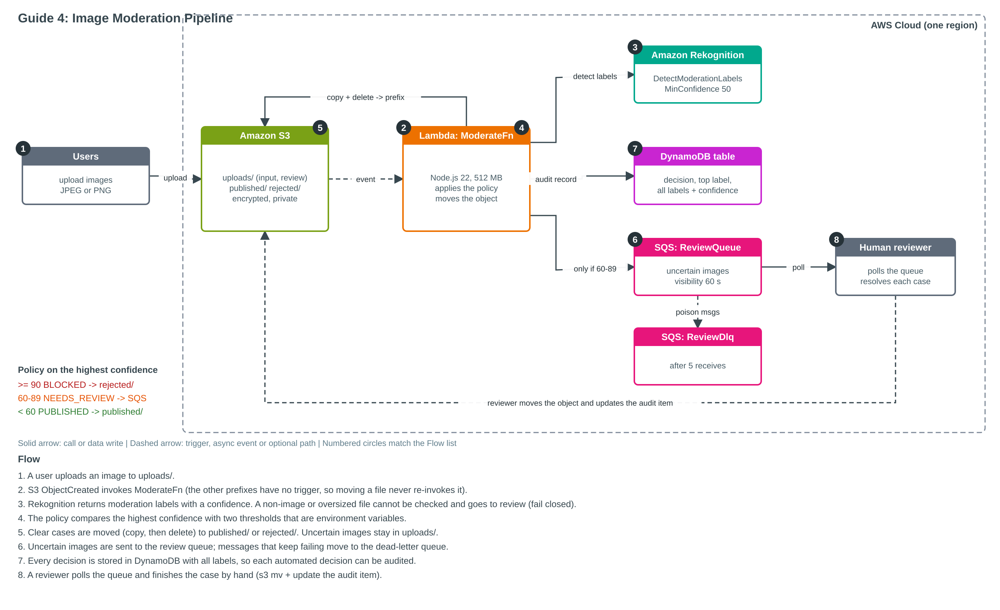

# Guide 4: Image Moderation Pipeline

Slide reference: **Case Study 4: Image Moderation Pipeline**.

Written for: students who completed the Prerequisites in [README.md](README.md).

## 1. Define the example

**Problem.** Users upload images to a platform. Clear cases must be handled automatically, and only uncertain images should reach a person. This controls cost and bias, as the slide says.

**Data flow (from the slide).** The numbers match the Flow list inside the diagram:



**Services and their role**

| Service | Role |
|---------|------|
| Amazon S3 | Receives uploads under `uploads/` and stores the final `published/` or `rejected/` copy |
| AWS Lambda | Triggered on upload; calls Rekognition; applies the policy; moves the file |
| Amazon Rekognition | `DetectModerationLabels` finds unsafe content with a confidence score |
| Amazon DynamoDB | Audit record for every decision |
| Amazon SQS | Queue of uncertain images waiting for a human reviewer |

**Decision rule (we implement this):**

| Highest moderation confidence | Decision | Where the file goes |
|-------------------------------|----------|---------------------|
| 90 or more | `BLOCKED` | `rejected/` |
| 60 to 89 | `NEEDS_REVIEW` | stays in `uploads/`, message sent to SQS |
| No label, or below 60 | `PUBLISHED` | `published/` |

The thresholds are environment variables, so you can tune them without a code change.

**Fail closed.** An image that Rekognition cannot read (wrong format, too large) is never published: it is treated as `NEEDS_REVIEW`. Temporary errors (throttling) are not caught, so Lambda retries them.

### Editing the diagram

Editable draw.io source: [diagrams/04-image-moderation-pipeline.drawio](diagrams/04-image-moderation-pipeline.drawio). Open it at [app.diagrams.net](https://app.diagrams.net) (File > Open from device) or with the draw.io extension in VS Code. The PNG and the `.drawio` are generated together by [diagrams/build_diagrams.py](diagrams/build_diagrams.py). Dashed arrows are triggers; solid arrows are calls or data writes.

### Design decisions (why this fits the problem)

| Decision | Reason | Trade-off |
|----------|--------|-----------|
| Two thresholds, not one | A single cut-off forces a yes/no on uncertain images; the middle band goes to a person, which controls cost and bias | Reviewer workload grows as the review band widens |
| Highest confidence decides | One strongly unsafe label is enough to block the image | A label with a high score for a harmless reason (art, medical) is blocked; the review band and a reviewer appeal path cover it |
| Trigger only on `uploads/` | `published/` and `rejected/` have no trigger, so moving a file never re-invokes the function | Uncertain images stay in `uploads/` until a person resolves them |
| Audit item with all labels | Anyone can check why an image was blocked, and the thresholds can be tuned from real data | Storage grows with traffic |
| Queue with a dead-letter queue | Review work survives reviewer downtime, and poison messages do not block the queue | Someone must read the DLQ |
| Fail closed on unreadable images | Publishing an image that was never checked defeats the purpose | Some legitimate uploads (unusual format) wait for a person |

## 2. Scaffold the project

This guide uses **Python** for both the infrastructure (AWS CDK in Python) and the Lambda function (boto3). You need Python 3.10 or later (`python3 --version`).

```bash
mkdir image-moderation && cd image-moderation
cdk init app --language python
source .venv/bin/activate            # cdk init creates .venv; if it does not exist: python3 -m venv .venv
pip install -r requirements.txt
mkdir lambda
```

Activate the virtual environment (`source .venv/bin/activate`) in every new terminal, because `cdk.json` runs `python3 app.py`.

`cdk init` creates `app.py` (entry point) and the package `image_moderation/` with `image_moderation_stack.py`. The Lambda uses `boto3`, which is already included in the Lambda Python runtime, so there is nothing to bundle.

## 3. Write the stack

Replace `image_moderation/image_moderation_stack.py`:

```python
from aws_cdk import (
    CfnOutput,
    Duration,
    RemovalPolicy,
    Stack,
    aws_dynamodb as dynamodb,
    aws_iam as iam,
    aws_lambda as _lambda,
    aws_logs as logs,
    aws_s3 as s3,
    aws_s3_notifications as s3n,
    aws_sqs as sqs,
)
from constructs import Construct


class ImageModerationStack(Stack):
    def __init__(self, scope: Construct, construct_id: str, **kwargs) -> None:
        super().__init__(scope, construct_id, **kwargs)

        bucket = s3.Bucket(
            self, "ImagesBucket",
            encryption=s3.BucketEncryption.S3_MANAGED,
            block_public_access=s3.BlockPublicAccess.BLOCK_ALL,
            enforce_ssl=True,
            removal_policy=RemovalPolicy.DESTROY,   # lab only
            auto_delete_objects=True,               # lab only
        )

        table = dynamodb.Table(
            self, "DecisionsTable",
            partition_key=dynamodb.Attribute(name="imageKey", type=dynamodb.AttributeType.STRING),
            billing_mode=dynamodb.BillingMode.PAY_PER_REQUEST,
            removal_policy=RemovalPolicy.DESTROY,   # lab only
        )

        # Dead-letter queue catches messages that fail repeatedly.
        dlq = sqs.Queue(
            self, "ReviewDlq",
            encryption=sqs.QueueEncryption.SQS_MANAGED,
            enforce_ssl=True,
        )
        review_queue = sqs.Queue(
            self, "ReviewQueue",
            encryption=sqs.QueueEncryption.SQS_MANAGED,
            enforce_ssl=True,
            visibility_timeout=Duration.seconds(60),
            dead_letter_queue=sqs.DeadLetterQueue(queue=dlq, max_receive_count=5),
        )

        fn = _lambda.Function(
            self, "ModerateFn",
            runtime=_lambda.Runtime.PYTHON_3_13,
            handler="moderate.handler",             # file lambda/moderate.py, function handler
            code=_lambda.Code.from_asset("lambda"),
            memory_size=512,
            timeout=Duration.seconds(30),
            log_group=logs.LogGroup(
                self, "ModerateLogs",
                retention=logs.RetentionDays.ONE_WEEK,
                removal_policy=RemovalPolicy.DESTROY,   # lab only
            ),
            dead_letter_queue=dlq,          # failed asynchronous invocations are kept, not lost
            environment={
                "BUCKET_NAME": bucket.bucket_name,
                "TABLE_NAME": table.table_name,
                "QUEUE_URL": review_queue.queue_url,
                "BLOCK_THRESHOLD": "90",
                "REVIEW_THRESHOLD": "60",
            },
        )

        bucket.grant_read_write(fn)         # read the upload, copy, and delete
        table.grant_write_data(fn)
        review_queue.grant_send_messages(fn)
        fn.add_to_role_policy(iam.PolicyStatement(
            actions=["rekognition:DetectModerationLabels"],
            resources=["*"],                # no resource-level permissions for this API
        ))

        bucket.add_event_notification(
            s3.EventType.OBJECT_CREATED,
            s3n.LambdaDestination(fn),
            s3.NotificationKeyFilter(prefix="uploads/"),
        )

        CfnOutput(self, "BucketName", value=bucket.bucket_name)
        CfnOutput(self, "TableName", value=table.table_name)
        CfnOutput(self, "ReviewQueueUrl", value=review_queue.queue_url)
```

Replace `app.py`:

```python
#!/usr/bin/env python3
import os

import aws_cdk as cdk

from image_moderation.image_moderation_stack import ImageModerationStack

app = cdk.App()
ImageModerationStack(
    app, "ImageModerationStack",
    env=cdk.Environment(
        account=os.environ.get("CDK_DEFAULT_ACCOUNT"),
        region=os.environ.get("CDK_DEFAULT_REGION"),
    ),
)
app.synth()
```

## 4. Write the Lambda handler

Create `lambda/moderate.py`:

```python
import json
import os
from datetime import datetime, timezone
from decimal import Decimal
from urllib.parse import unquote_plus

import boto3
from botocore.exceptions import ClientError

s3 = boto3.client("s3")
rekognition = boto3.client("rekognition")
sqs = boto3.client("sqs")
table = boto3.resource("dynamodb").Table(os.environ["TABLE_NAME"])

BLOCK_THRESHOLD = float(os.environ.get("BLOCK_THRESHOLD", "90"))
REVIEW_THRESHOLD = float(os.environ.get("REVIEW_THRESHOLD", "60"))

# Errors that mean "Rekognition cannot read this file". Any other error is retried by Lambda.
UNREADABLE_ERRORS = {"InvalidImageFormatException", "ImageTooLargeException"}


def move(bucket, source_key, target_key):
    """Move the object: copy to the new prefix, then delete the original."""
    s3.copy_object(
        Bucket=bucket,
        Key=target_key,
        CopySource={"Bucket": bucket, "Key": source_key},
    )
    s3.delete_object(Bucket=bucket, Key=source_key)


def dec(value):
    """DynamoDB does not accept Python floats: use Decimal."""
    return Decimal(str(value))


def handler(event, context):
    bucket = os.environ["BUCKET_NAME"]

    for record in event["Records"]:
        key = unquote_plus(record["s3"]["object"]["key"])   # S3 events encode spaces as "+"
        filename = key.removeprefix("uploads/")

        # 1. Ask Rekognition for moderation labels.
        labels = []
        unreadable = False
        try:
            result = rekognition.detect_moderation_labels(
                Image={"S3Object": {"Bucket": bucket, "Name": key}},
                MinConfidence=50,
            )
            labels = result.get("ModerationLabels", [])
        except ClientError as err:
            # Not an image Rekognition can read: do not publish it unchecked.
            if err.response["Error"]["Code"] not in UNREADABLE_ERRORS:
                raise
            unreadable = True

        top = max((label["Confidence"] for label in labels), default=0.0)
        if unreadable:
            top_label = "unreadable-image"
        elif labels:
            top_label = max(labels, key=lambda label: label["Confidence"])["Name"]
        else:
            top_label = "none"

        # 2. Apply the policy.
        if unreadable:
            decision = "NEEDS_REVIEW"
        elif top >= BLOCK_THRESHOLD:
            decision = "BLOCKED"
        elif top >= REVIEW_THRESHOLD:
            decision = "NEEDS_REVIEW"
        else:
            decision = "PUBLISHED"

        # 3. Act on the decision.
        if decision == "PUBLISHED":
            move(bucket, key, f"published/{filename}")
        elif decision == "BLOCKED":
            move(bucket, key, f"rejected/{filename}")
        else:
            # Uncertain: leave the image in uploads/ and ask a person to decide.
            sqs.send_message(
                QueueUrl=os.environ["QUEUE_URL"],
                MessageBody=json.dumps({"key": key, "topLabel": top_label, "confidence": top}),
            )

        # 4. Audit record.
        table.put_item(Item={
            "imageKey": key,
            "decision": decision,
            "topLabel": top_label,
            "confidence": dec(top),
            "labels": [
                {
                    "name": label["Name"],
                    "parent": label.get("ParentName", ""),
                    "confidence": dec(label["Confidence"]),
                }
                for label in labels
            ],
            "decidedAt": datetime.now(timezone.utc).isoformat(),
        })
```

## 5. Deploy

```bash
cdk synth
cdk deploy
```

## 6. Test

### 6.1 Test with the AWS console (UI)

1. **CloudFormation** > Stacks > `ImageModerationStack` > **Outputs**. Copy `BucketName`, `TableName` and `ReviewQueueUrl`.
2. **S3** > the bucket > **Create folder** `uploads` > open it > **Upload** `safe.jpg`.
3. Wait about 10 seconds. Go back to the bucket root: `published/` should contain `safe.jpg` and `uploads/` should be empty.
4. **DynamoDB** > Tables > `DecisionsTable` > **Explore table items**. The item for `uploads/safe.jpg` must show `decision` = `PUBLISHED`.
5. Upload a clearly unsafe test image (from a moderation test dataset) to `uploads/`. Confirm it lands in `rejected/` with decision `BLOCKED`.
6. Upload a borderline image. Confirm it stays in `uploads/` with decision `NEEDS_REVIEW`.
7. **Amazon SQS** > Queues > `ReviewQueue` > **Send and receive messages** > **Poll for messages**. Open the message to read the key and confirm, then **Delete** it.
8. Optional: **Amazon Rekognition** > **Try demo** > **Image moderation**. Upload the same borderline image and compare the labels with the ones in the audit record.

Pass criteria: each image ends in the expected prefix, the table holds one decision per image, and the review queue holds only the borderline case.

### 6.2 Test with the AWS CLI

Use three test images: a clearly safe photo, a clearly unsafe one (use a test image from a moderation dataset, not real content), and one borderline image. Keep test content in your lab account only.

```bash
BUCKET=$(aws cloudformation describe-stacks --stack-name ImageModerationStack \
  --query "Stacks[0].Outputs[?OutputKey=='BucketName'].OutputValue" --output text)
TABLE=$(aws cloudformation describe-stacks --stack-name ImageModerationStack \
  --query "Stacks[0].Outputs[?OutputKey=='TableName'].OutputValue" --output text)
QUEUE=$(aws cloudformation describe-stacks --stack-name ImageModerationStack \
  --query "Stacks[0].Outputs[?OutputKey=='ReviewQueueUrl'].OutputValue" --output text)

aws s3 cp ./safe.jpg s3://$BUCKET/uploads/safe.jpg
aws s3 cp ./borderline.jpg s3://$BUCKET/uploads/borderline.jpg

# After a few seconds: decisions per image.
aws dynamodb scan --table-name $TABLE

# Where did the files go?
aws s3 ls s3://$BUCKET/published/
aws s3 ls s3://$BUCKET/rejected/
aws s3 ls s3://$BUCKET/uploads/

# Human review queue (receive, inspect, and delete the message when done).
aws sqs receive-message --queue-url $QUEUE --max-number-of-messages 1
```

Expected:

- `safe.jpg` is `PUBLISHED` and appears under `published/`.
- A clearly unsafe image is `BLOCKED` and appears under `rejected/`.
- The borderline image is `NEEDS_REVIEW`, stays in `uploads/`, and its key is in the SQS queue.

### 6.3 Resolve a review case

The pipeline leaves the uncertain image in `uploads/`. A reviewer finishes the case by hand and records it in the audit item:

```bash
# The reviewer approves borderline.jpg (use rejected/ to reject it).
aws s3 mv s3://$BUCKET/uploads/borderline.jpg s3://$BUCKET/published/borderline.jpg
aws dynamodb update-item --table-name $TABLE \
  --key '{"imageKey":{"S":"uploads/borderline.jpg"}}' \
  --update-expression "SET decision = :d, reviewedAt = :t" \
  --expression-attribute-values '{":d":{"S":"PUBLISHED_BY_REVIEWER"},":t":{"S":"2025-01-01T00:00:00Z"}}'
```

Then delete the queue message. A real system would put this behind a small review console; the point here is that every case ends in `published/` or `rejected/` and in an audit record.

To change how strict the policy is, redeploy with different values in `BLOCK_THRESHOLD` and `REVIEW_THRESHOLD`. Do not lower the review threshold to zero: a very low threshold sends almost every image to a person.

## 7. Clean up

```bash
cdk destroy ImageModerationStack
```

## What you practiced

- Event-driven processing on upload.
- Using an AI service's confidence score in a business rule, instead of trusting a yes/no answer.
- Human-in-the-loop with a queue and a dead-letter queue, and resolving a case by hand.
- Failing closed: an image that could not be checked is never published.
- Auditing every automated decision.
