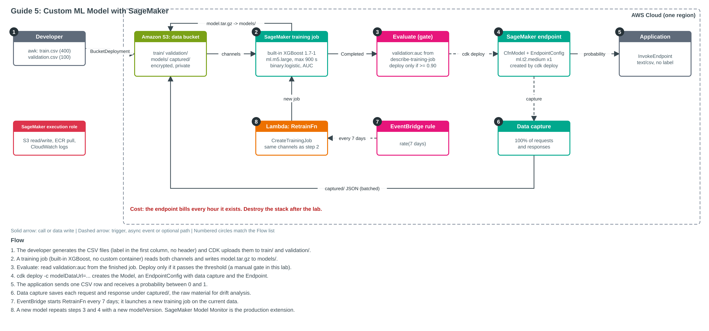

# Guide 5: Custom ML Model with SageMaker

Slide reference: **Case Study 5: Custom ML Model with SageMaker**.

Written for: students who completed the Prerequisites in [README.md](README.md). This is the most expensive guide because of the real-time endpoint: follow the cost notes.

## 1. Define the example

**Problem.** The company has its own tabular data (for example, "will this customer churn?") and needs a model that no pre-built AI service offers. We train a model, deploy it behind an endpoint, capture the requests for monitoring, and retrain on a schedule.

**Data flow (from the slide).** The numbers match the Flow list inside the diagram:



**Services and their role**

| Service | Role |
|---------|------|
| Amazon S3 | Training data, model artifacts, captured inference data |
| SageMaker training job | Trains a built-in XGBoost model on the data |
| SageMaker model, endpoint configuration, endpoint | Serves the model over HTTPS (real-time inference) |
| SageMaker data capture | Saves the input and output of each request to S3, for monitoring |
| EventBridge + Lambda | Runs a retraining job on a schedule |
| IAM | Execution role for SageMaker and for the retraining Lambda |

**Evaluate before deploying.** The slide has an Evaluate stage. We keep 20% of the data as a validation channel, XGBoost reports `validation:auc` for it, and we deploy only if the value passes a threshold (0.90). In this lab the gate is a manual command; a SageMaker Pipeline automates it (extension).

**Scope.** We use the built-in XGBoost algorithm, so there is no custom container. "Monitor drift" is simplified here to "data is captured and retraining runs on a schedule". Amazon SageMaker Model Monitor is the production option and is listed under extensions.

### Editing the diagram

Editable draw.io source: [diagrams/05-custom-ml-sagemaker.drawio](diagrams/05-custom-ml-sagemaker.drawio). Open it at [app.diagrams.net](https://app.diagrams.net) (File > Open from device) or with the draw.io extension in VS Code. The PNG and the `.drawio` are generated together by [diagrams/build_diagrams.py](diagrams/build_diagrams.py). Dashed arrows are triggers; solid arrows are calls or data writes.

### Design decisions (why this fits the problem)

| Decision | Reason | Trade-off |
|----------|--------|-----------|
| Built-in XGBoost | Tabular data with a binary label is its strength; no container to build or maintain | Only the algorithm's hyperparameters can change |
| Training outside CDK | CDK describes infrastructure that stays; a training job is a one-time run. The endpoint stack is created only after a model exists | Three deploy stages instead of one |
| Validation channel and an AUC gate | A model that was not measured should not serve traffic | The threshold (0.90) fits this synthetic data; choose yours from the business cost of errors |
| Data capture at 100% | The captured inputs are the baseline for drift checks | Storage grows; lower the sampling in production |
| Weekly retraining job, no automatic deploy | Retraining is cheap; replacing the live model without evaluation is risky | A person (or a pipeline) must run the gate and deploy |
| One small always-on instance | Real-time inference needs an instance running | It bills every hour: destroy it after the lab |

## 2. Scaffold the project

This guide uses **Python** for both the infrastructure (AWS CDK in Python) and the Lambda function (boto3). You need Python 3.10 or later (`python3 --version`).

```bash
mkdir ml-churn && cd ml-churn
cdk init app --language python
source .venv/bin/activate            # cdk init creates .venv; if it does not exist: python3 -m venv .venv
pip install -r requirements.txt
mkdir lambda data
```

Activate the virtual environment in every new terminal. `cdk init` creates `app.py` and the package `ml_churn/` with `ml_churn_stack.py`. The Lambda uses `boto3`, which the Lambda Python runtime already includes, so there is nothing to bundle.

## 3. Prepare the data

XGBoost (CSV format) expects the label in the first column and no header. Generate a small synthetic dataset of 500 rows with three anonymous features (think of them as tenure, usage and support tickets, scaled to 0 to 1; the label is 1 when `a + b > 1`). Keep 400 rows for training and 100 for validation. A small Python script does it (save it as `make_data.py` in the project folder and run it):

```python
import csv
import random
from pathlib import Path

random.seed(1)
rows = []
for _ in range(500):
    a, b, c = random.random(), random.random(), random.random()
    y = 1 if a + b > 1 else 0
    rows.append([y, round(a, 6), round(b, 6), round(c, 6)])

for folder, name, part in [("train", "train.csv", rows[:400]),
                           ("validation", "validation.csv", rows[400:])]:
    Path(f"data/{folder}").mkdir(parents=True, exist_ok=True)
    with open(f"data/{folder}/{name}", "w", newline="") as f:
        csv.writer(f).writerows(part)
```

```bash
python3 make_data.py
head -3 data/train/train.csv
```

## 4. Write the stack

Replace `ml_churn/ml_churn_stack.py`. The stack creates the storage, the roles, the model, the endpoint configuration with data capture, the endpoint, and the retraining schedule.

```python
from aws_cdk import (
    CfnOutput,
    Duration,
    RemovalPolicy,
    Stack,
    aws_events as events,
    aws_events_targets as targets,
    aws_iam as iam,
    aws_lambda as _lambda,
    aws_logs as logs,
    aws_s3 as s3,
    aws_s3_deployment as s3deploy,
    aws_sagemaker as sagemaker,
)
from constructs import Construct


class MlChurnStack(Stack):
    def __init__(self, scope: Construct, construct_id: str, **kwargs) -> None:
        super().__init__(scope, construct_id, **kwargs)

        # Context values, passed with -c on the command line.
        model_version = self.node.try_get_context("modelVersion") or "v1"
        model_data_url = self.node.try_get_context("modelDataUrl")   # s3://.../model.tar.gz
        # Built-in XGBoost image. Image URIs are region specific: look up yours in the
        # SageMaker "Common parameters for built-in algorithms" page.
        inference_image = (
            self.node.try_get_context("inferenceImage")
            or "683313688378.dkr.ecr.us-east-1.amazonaws.com/sagemaker-xgboost:1.7-1"
        )

        # Data, model artifacts, and captured requests.
        data_bucket = s3.Bucket(
            self, "MlDataBucket",
            encryption=s3.BucketEncryption.S3_MANAGED,
            block_public_access=s3.BlockPublicAccess.BLOCK_ALL,
            enforce_ssl=True,
            removal_policy=RemovalPolicy.DESTROY,   # lab only
            auto_delete_objects=True,               # lab only
        )
        # data/train/train.csv -> s3://bucket/train/train.csv, data/validation/validation.csv -> .../validation/
        s3deploy.BucketDeployment(
            self, "DeployTrainingData",
            sources=[s3deploy.Source.asset("./data")],
            destination_bucket=data_bucket,
        )

        # SageMaker execution role: read data, write artifacts and captures, write logs.
        sagemaker_role = iam.Role(
            self, "SageMakerExecutionRole",
            assumed_by=iam.ServicePrincipal("sagemaker.amazonaws.com"),
        )
        data_bucket.grant_read_write(sagemaker_role)
        sagemaker_role.add_to_policy(iam.PolicyStatement(
            actions=[
                "logs:CreateLogGroup", "logs:CreateLogStream", "logs:PutLogEvents",
                "cloudwatch:PutMetricData", "ecr:GetAuthorizationToken",
                "ecr:BatchCheckLayerAvailability", "ecr:GetDownloadUrlForLayer", "ecr:BatchGetImage",
            ],
            resources=["*"],
        ))

        # Model: points to the trained artifact in S3 and to the inference container.
        # Created only after you pass the artifact location with -c modelDataUrl=...
        if model_data_url:
            model = sagemaker.CfnModel(
                self, "ChurnModel",
                model_name=f"churn-model-{model_version}",
                execution_role_arn=sagemaker_role.role_arn,
                primary_container=sagemaker.CfnModel.ContainerDefinitionProperty(
                    image=inference_image,
                    model_data_url=model_data_url,
                ),
            )

            endpoint_config = sagemaker.CfnEndpointConfig(
                self, "ChurnEndpointConfig",
                endpoint_config_name=f"churn-config-{model_version}",
                production_variants=[sagemaker.CfnEndpointConfig.ProductionVariantProperty(
                    model_name=model.model_name,
                    variant_name="AllTraffic",
                    initial_instance_count=1,
                    instance_type="ml.t2.medium",
                    initial_variant_weight=1,
                )],
                # Save every request and response to S3 for drift analysis.
                data_capture_config=sagemaker.CfnEndpointConfig.DataCaptureConfigProperty(
                    enable_capture=True,
                    initial_sampling_percentage=100,
                    destination_s3_uri=f"s3://{data_bucket.bucket_name}/captured",
                    capture_options=[
                        sagemaker.CfnEndpointConfig.CaptureOptionProperty(capture_mode="Input"),
                        sagemaker.CfnEndpointConfig.CaptureOptionProperty(capture_mode="Output"),
                    ],
                ),
            )
            endpoint_config.add_dependency(model)

            endpoint = sagemaker.CfnEndpoint(
                self, "ChurnEndpoint",
                endpoint_name="churn-endpoint",
                endpoint_config_name=endpoint_config.endpoint_config_name,
            )
            endpoint.add_dependency(endpoint_config)

            CfnOutput(self, "EndpointName", value=endpoint.endpoint_name)

        # Retraining: a Lambda starts a new training job every week.
        retrain_fn = _lambda.Function(
            self, "RetrainFn",
            runtime=_lambda.Runtime.PYTHON_3_13,
            handler="retrain.handler",              # file lambda/retrain.py, function handler
            code=_lambda.Code.from_asset("lambda"),
            timeout=Duration.seconds(30),
            log_group=logs.LogGroup(
                self, "RetrainLogs",
                retention=logs.RetentionDays.ONE_WEEK,
                removal_policy=RemovalPolicy.DESTROY,   # lab only
            ),
            environment={
                "TRAINING_IMAGE": inference_image,
                "ROLE_ARN": sagemaker_role.role_arn,
                "TRAIN_URI": f"s3://{data_bucket.bucket_name}/train/",
                "VALIDATION_URI": f"s3://{data_bucket.bucket_name}/validation/",
                "OUTPUT_URI": f"s3://{data_bucket.bucket_name}/models/",
            },
        )
        retrain_fn.add_to_role_policy(iam.PolicyStatement(
            actions=["sagemaker:CreateTrainingJob"],
            resources=["*"],
        ))
        retrain_fn.add_to_role_policy(iam.PolicyStatement(
            actions=["iam:PassRole"],
            resources=[sagemaker_role.role_arn],
        ))

        events.Rule(
            self, "WeeklyRetrainRule",
            schedule=events.Schedule.rate(Duration.days(7)),
            targets=[targets.LambdaFunction(retrain_fn)],
        )

        CfnOutput(self, "DataBucketName", value=data_bucket.bucket_name)
        CfnOutput(self, "SageMakerRoleArn", value=sagemaker_role.role_arn)
```

Replace `app.py`:

```python
#!/usr/bin/env python3
import os

import aws_cdk as cdk

from ml_churn.ml_churn_stack import MlChurnStack

app = cdk.App()
MlChurnStack(
    app, "MlChurnStack",
    env=cdk.Environment(
        account=os.environ.get("CDK_DEFAULT_ACCOUNT"),
        region=os.environ.get("CDK_DEFAULT_REGION"),
    ),
)
app.synth()
```

Note: the `TRAINING_IMAGE` variable reuses the XGBoost image. For the built-in XGBoost algorithm, training and inference use the same image.

## 5. Write the retraining Lambda

Create `lambda/retrain.py`:

```python
import os
from datetime import datetime, timezone

import boto3

sagemaker = boto3.client("sagemaker")


def handler(event, context):
    # Job names must be unique and at most 63 characters.
    job_name = "churn-retrain-" + datetime.now(timezone.utc).strftime("%Y-%m-%d-%H-%M-%S")

    sagemaker.create_training_job(
        TrainingJobName=job_name,
        AlgorithmSpecification={
            "TrainingImage": os.environ["TRAINING_IMAGE"],
            "TrainingInputMode": "File",
        },
        RoleArn=os.environ["ROLE_ARN"],
        HyperParameters={
            "objective": "binary:logistic",
            "eval_metric": "auc",            # reported as validation:auc
            "num_round": "50",
        },
        InputDataConfig=[
            {
                "ChannelName": channel,
                "ContentType": "text/csv",
                "DataSource": {
                    "S3DataSource": {
                        "S3DataType": "S3Prefix",
                        "S3Uri": os.environ[env_var],
                        "S3DataDistributionType": "FullyReplicated",
                    },
                },
            }
            for channel, env_var in [("train", "TRAIN_URI"), ("validation", "VALIDATION_URI")]
        ],
        OutputDataConfig={"S3OutputPath": os.environ["OUTPUT_URI"]},
        ResourceConfig={"InstanceType": "ml.m5.large", "InstanceCount": 1, "VolumeSizeInGB": 10},
        StoppingCondition={"MaxRuntimeInSeconds": 900},
    )
    return {"trainingJobName": job_name}
```

## 6. Deploy in three stages

**Stage A: data, roles and the retraining schedule.** The endpoint is not created yet, because it needs a trained model.

```bash
cdk synth
cdk deploy
```

**Stage B: train the first model and evaluate it.** The data is in `s3://<DataBucketName>/train/train.csv` and `.../validation/validation.csv`. Run the training job with the CLI, using the role output by the stack:

```bash
BUCKET=$(aws cloudformation describe-stacks --stack-name MlChurnStack \
  --query "Stacks[0].Outputs[?OutputKey=='DataBucketName'].OutputValue" --output text)
ROLE=$(aws cloudformation describe-stacks --stack-name MlChurnStack \
  --query "Stacks[0].Outputs[?OutputKey=='SageMakerRoleArn'].OutputValue" --output text)
IMAGE=683313688378.dkr.ecr.us-east-1.amazonaws.com/sagemaker-xgboost:1.7-1

channel() {   # name, S3 prefix
  echo "{\"ChannelName\":\"$1\",\"ContentType\":\"text/csv\",\"DataSource\":{\"S3DataSource\":{\"S3DataType\":\"S3Prefix\",\"S3Uri\":\"s3://$BUCKET/$2/\",\"S3DataDistributionType\":\"FullyReplicated\"}}}"
}
CHANNELS="[$(channel train train),$(channel validation validation)]"

JOB=churn-v1-$(date +%s)
aws sagemaker create-training-job \
  --training-job-name $JOB \
  --algorithm-specification TrainingImage=$IMAGE,TrainingInputMode=File \
  --role-arn $ROLE \
  --hyper-parameters objective=binary:logistic,eval_metric=auc,num_round=50 \
  --input-data-config "$CHANNELS" \
  --output-data-config S3OutputPath=s3://$BUCKET/models/ \
  --resource-config InstanceType=ml.m5.large,InstanceCount=1,VolumeSizeInGB=10 \
  --stopping-condition MaxRuntimeInSeconds=900

# Wait until TrainingJobStatus is Completed (about 5 minutes).
aws sagemaker wait training-job-completed-or-stopped --training-job-name $JOB
aws sagemaker describe-training-job --training-job-name $JOB \
  --query "{Status:TrainingJobStatus, Model:ModelArtifacts.S3ModelArtifacts}"
```

**Evaluate gate.** Read the validation AUC and continue only if it passes the threshold:

```bash
AUC=$(aws sagemaker describe-training-job --training-job-name $JOB \
  --query "FinalMetricDataList[?MetricName=='validation:auc'].Value | [0]" --output text)
echo "validation:auc = $AUC"
awk -v a="$AUC" 'BEGIN { exit !(a >= 0.90) }' && echo "PASS: deploy" || echo "FAIL: do not deploy"
```

The synthetic rule `a + b > 1` is easy to learn, so the AUC should be close to 1. With real data, pick the threshold from the cost of a wrong prediction.

Copy the `Model` value (it ends in `model.tar.gz`).

**Stage C: deploy the endpoint.** Pass the artifact location to CDK:

```bash
cdk deploy -c modelDataUrl=<S3ModelArtifactsValue> -c modelVersion=v1
```

Endpoint creation takes about 5 to 10 minutes. Check it:

```bash
aws sagemaker describe-endpoint --endpoint-name churn-endpoint --query EndpointStatus
```

## 7. Test

### 7.1 Test with the AWS console (UI)

1. **S3** > the data bucket > confirm `train/train.csv` and `validation/validation.csv` exist. Open one to see the three-feature rows with the label in the first column.
2. **Amazon SageMaker AI** > **Training** > **Training jobs**. Select the job you created in Stage B and confirm the status is **Completed**. Under **Metrics**, check `validation:auc`; under **Output**, note the **Model artifacts** S3 path.
3. **Amazon SageMaker AI** > **Inference** > **Endpoints** > `churn-endpoint`. Confirm the status is **InService**.
4. On the endpoint page, open **Test inference**. Set the content type to `text/csv` and enter `0.9,0.8,0.1`. Run it. A value near 1 is expected.
5. **S3** > the data bucket > `captured/`. After a few requests, JSON files appear here (wait about a minute, since capture is batched).
6. **Lambda** > Functions > `RetrainFn` > **Test** > create an event with body `{}` > **Test**. Then **SageMaker AI** > **Training jobs** and confirm a new job named `churn-retrain-...` appears.

Pass criteria: the validation AUC passes the gate, the endpoint is InService, returns a prediction, writes captured data, and the retraining Lambda starts a training job.

### 7.2 Test with the AWS CLI

Invoke the endpoint with one row of features (no label):

```bash
aws sagemaker-runtime invoke-endpoint \
  --endpoint-name churn-endpoint \
  --content-type text/csv \
  --body "0.9,0.8,0.1" prediction.txt
cat prediction.txt
```

A value close to 1 means the model predicts class 1 (because `a + b > 1` in the training data). A value close to 0 means class 0.

Check that data capture works. Captured records appear under `captured/` after a few requests (capture is batched, so wait a minute):

```bash
aws s3 ls s3://$BUCKET/captured/ --recursive | head
```

**Retraining test.** Invoke the retraining Lambda manually and confirm a new job appears:

```bash
aws lambda invoke --function-name $(aws lambda list-functions \
    --query "Functions[?contains(FunctionName, 'RetrainFn')].FunctionName" --output text) \
  response.json
aws sagemaker list-training-jobs --sort-by CreationTime --sort-order Descending --max-results 3
```

## 8. Clean up

The endpoint is billed per hour even when idle. Destroy the stack as soon as you finish:

```bash
cdk destroy MlChurnStack
aws sagemaker list-endpoints     # confirm no endpoint remains
```

If `destroy` fails because the endpoint still exists, delete it first with `aws sagemaker delete-endpoint --endpoint-name churn-endpoint`, then run `destroy` again.

## Extensions

- Replace the simplified monitoring with **SageMaker Model Monitor** (data quality and drift baselines against the captured data).
- Add a **CodePipeline** stage that runs the training, evaluation and deployment steps on every commit to the data repository (the slide's MLOps box).
- Put a **SageMaker Pipeline** in front of training to automate the evaluate step with a metric threshold before deploying.

## What you practiced

- The ML lifecycle as infrastructure: data, training, evaluation, model, endpoint.
- Gating a deployment on a validation metric.
- Separating training from deployment (CDK deploys the serving stack; training runs as a job).
- Data capture for monitoring, and a scheduled retraining loop.
- The cost of always-on inference, and how to tear it down.
