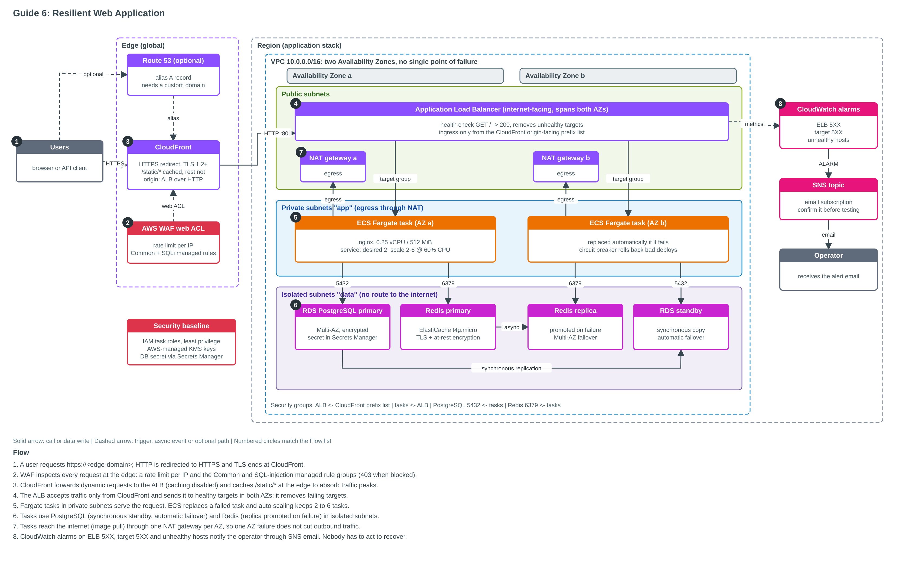

# Guide 6: Resilient Web Application

Slide reference: **Case Study 6: Resilient Web Application**.

Written for: students who completed the Prerequisites in [README.md](README.md). This is the most expensive guide (NAT gateways, load balancer, Multi-AZ database, cache). Do it last, and destroy it the same day. Rough on-demand cost in us-east-1: about USD 0.20 to 0.25 per hour (two NAT gateways ~0.09, Multi-AZ database ~0.03, two cache nodes ~0.03, load balancer ~0.02, two small Fargate tasks ~0.03, plus WAF), so a full day is about USD 5. Check the AWS pricing pages for current values.

## 1. Define the example

**Problem.** A web application must keep serving users when an Availability Zone (AZ) fails, and must absorb attacks at the edge. No one should have to intervene manually.

**Data flow (from the slide).** The numbers match the Flow list inside the diagram:



**Services and their role**

| Service | Role | Resilience property |
|---------|------|---------------------|
| Route 53 | DNS entry (optional in this lab, see Extensions) | Global DNS |
| CloudFront | Caches and terminates TLS at the edge | Absorbs traffic peaks |
| AWS WAF | Blocks common web attacks (managed rules) | Protects availability |
| Application Load Balancer | Spreads requests over healthy tasks in 2 AZs | Removes unhealthy targets |
| ECS on Fargate | Runs the containers, desired count 2, auto scaling | Replaces failed tasks |
| RDS PostgreSQL Multi-AZ | Synchronous standby in another AZ, automatic failover | Survives an AZ failure |
| ElastiCache for Redis | Cache with a replica and automatic failover | Reduces database load |
| CloudWatch alarm + SNS | Alerts on 5xx errors from the load balancer | Early warning |
| VPC, IAM, KMS | Network isolation, least privilege, encryption | Security baseline |

**Requirements**

- Two AZs, no single point of failure in the request path.
- A failed task or AZ is replaced without human action.
- The database fails over automatically.
- Edge protection with WAF managed rules, and **no way to reach the application except through that edge**.
- An alert reaches a person when users see errors, including when every task is down.

**Scope.** The container is the public nginx image, a placeholder for your application. The database and the cache are created, encrypted and reachable from the tasks (security groups), but nginx does not use them. The lab proves the resilience mechanisms, not an application.

### Editing the diagram

Editable draw.io source: [diagrams/06-resilient-web-application.drawio](diagrams/06-resilient-web-application.drawio). Open it at [app.diagrams.net](https://app.diagrams.net) (File > Open from device) or with the draw.io extension in VS Code. The PNG and the `.drawio` are generated together by [diagrams/build_diagrams.py](diagrams/build_diagrams.py). Dashed arrows are triggers or optional paths; solid arrows are requests or calls. The WAF stack lives in us-east-1 and is not inside the VPC.

### Design decisions (why this fits the problem)

| Problem requirement | Decision | Trade-off |
|---------------------|----------|-----------|
| Survive an AZ failure | ALB, Fargate tasks, database and cache each span two AZs, and there is one NAT gateway per AZ | About double the idle cost; a single NAT would be cheaper but its AZ failure would cut outbound traffic |
| No manual recovery | ECS service with desired count 2 replaces tasks; RDS and ElastiCache fail over by themselves; the deployment circuit breaker rolls back a bad release | RDS failover still drops connections for tens of seconds, so the app must retry |
| Absorb attacks at the edge | WAF with a rate limit and the Common and SQL-injection managed rules, attached to CloudFront | Managed rules can give false positives; use Count mode first in a real system |
| Edge protection must not be bypassable | The ALB security group admits only the CloudFront origin-facing prefix list (`open_listener=False`) | The managed prefix list uses about 55 of the 60 default rules of a security group |
| Absorb peaks | `/static/*` is cached at the edge; dynamic paths are not cached | A cache with a long TTL would absorb more but could serve stale data |
| Know when users are hurt | Three alarms: target 5XX (app errors), ELB 5XX (raised when **no** target is healthy), unhealthy host count | Email only; a real team adds paging and a runbook |

## 2. Scaffold the project

This guide uses **Python** for the infrastructure (AWS CDK in Python). You need Python 3.10 or later (`python3 --version`).

```bash
mkdir resilient-web && cd resilient-web
cdk init app --language python
source .venv/bin/activate            # cdk init creates .venv; if it does not exist: python3 -m venv .venv
pip install -r requirements.txt
```

Activate the virtual environment in every new terminal. `cdk init` creates `app.py` and the package `resilient_web/`. No Lambda functions are needed in this guide, so there is no function code to write or bundle.

## 3. Write the stacks

WAF for CloudFront must be created in **us-east-1**, whatever region the application uses. We therefore use two stacks: a WAF stack in `us-east-1`, and the application stack in your region.

### 3.1 WAF stack

Create `resilient_web/waf_stack.py`:

```python
from aws_cdk import CfnOutput, Stack, aws_wafv2 as wafv2
from constructs import Construct


def visibility(metric_name: str) -> wafv2.CfnWebACL.VisibilityConfigProperty:
    return wafv2.CfnWebACL.VisibilityConfigProperty(
        cloud_watch_metrics_enabled=True,
        metric_name=metric_name,
        sampled_requests_enabled=True,
    )


class WafStack(Stack):
    def __init__(self, scope: Construct, construct_id: str, **kwargs) -> None:
        super().__init__(scope, construct_id, **kwargs)

        acl = wafv2.CfnWebACL(
            self, "EdgeWebAcl",
            scope="CLOUDFRONT",               # CloudFront WAF ACLs must live in us-east-1
            default_action=wafv2.CfnWebACL.DefaultActionProperty(allow={}),
            visibility_config=visibility("resilientWebAcl"),
            rules=[
                # Flood protection: block an IP that sends more than 500 requests in 5 minutes.
                wafv2.CfnWebACL.RuleProperty(
                    name="RateLimitPerIp",
                    priority=0,
                    action=wafv2.CfnWebACL.RuleActionProperty(block={}),
                    statement=wafv2.CfnWebACL.StatementProperty(
                        rate_based_statement=wafv2.CfnWebACL.RateBasedStatementProperty(
                            limit=500, aggregate_key_type="IP",
                        ),
                    ),
                    visibility_config=visibility("rateLimitPerIp"),
                ),
                # Broad web exploits: cross-site scripting, bad inputs, oversized bodies.
                wafv2.CfnWebACL.RuleProperty(
                    name="AWSCommonRules",
                    priority=1,
                    override_action=wafv2.CfnWebACL.OverrideActionProperty(none={}),  # keep the group's own actions
                    statement=wafv2.CfnWebACL.StatementProperty(
                        managed_rule_group_statement=wafv2.CfnWebACL.ManagedRuleGroupStatementProperty(
                            vendor_name="AWS", name="AWSManagedRulesCommonRuleSet",
                        ),
                    ),
                    visibility_config=visibility("awsCommonRules"),
                ),
                # SQL injection patterns. They are NOT in the Common rule set.
                wafv2.CfnWebACL.RuleProperty(
                    name="AWSSqliRules",
                    priority=2,
                    override_action=wafv2.CfnWebACL.OverrideActionProperty(none={}),
                    statement=wafv2.CfnWebACL.StatementProperty(
                        managed_rule_group_statement=wafv2.CfnWebACL.ManagedRuleGroupStatementProperty(
                            vendor_name="AWS", name="AWSManagedRulesSQLiRuleSet",
                        ),
                    ),
                    visibility_config=visibility("awsSqliRules"),
                ),
            ],
        )

        self.web_acl_arn = acl.attr_arn
        CfnOutput(self, "WebAclArn", value=acl.attr_arn)
```

### 3.2 Application stack

Create `resilient_web/resilient_web_stack.py`:

```python
from aws_cdk import (
    CfnOutput,
    Duration,
    RemovalPolicy,
    Stack,
    aws_cloudfront as cloudfront,
    aws_cloudfront_origins as origins,
    aws_cloudwatch as cloudwatch,
    aws_cloudwatch_actions as cw_actions,
    aws_ec2 as ec2,
    aws_ecs as ecs,
    aws_ecs_patterns as ecs_patterns,
    aws_elasticache as elasticache,
    aws_elasticloadbalancingv2 as elbv2,
    aws_rds as rds,
    aws_sns as sns,
    aws_sns_subscriptions as subs,
)
from constructs import Construct


class ResilientWebStack(Stack):
    def __init__(
        self,
        scope: Construct,
        construct_id: str,
        *,
        web_acl_arn: str,                 # from the WAF stack output (WebAclArn)
        cloudfront_prefix_list_id: str,   # managed prefix list of the CloudFront origin-facing servers
        alert_email: str,
        **kwargs,
    ) -> None:
        super().__init__(scope, construct_id, **kwargs)

        # 1. Network: two AZs. Public subnets for the load balancer,
        #    private subnets with egress for tasks, isolated subnets for data.
        vpc = ec2.Vpc(
            self, "Vpc",
            max_azs=2,
            nat_gateways=2,         # one per AZ, so an AZ failure does not cut outbound traffic
            subnet_configuration=[
                ec2.SubnetConfiguration(name="public", subnet_type=ec2.SubnetType.PUBLIC, cidr_mask=24),
                ec2.SubnetConfiguration(name="app", subnet_type=ec2.SubnetType.PRIVATE_WITH_EGRESS, cidr_mask=24),
                ec2.SubnetConfiguration(name="data", subnet_type=ec2.SubnetType.PRIVATE_ISOLATED, cidr_mask=24),
            ],
        )

        # 2. Database: PostgreSQL with a synchronous standby in another AZ.
        db = rds.DatabaseInstance(
            self, "Db",
            engine=rds.DatabaseInstanceEngine.postgres(version=rds.PostgresEngineVersion.VER_16),
            instance_type=ec2.InstanceType.of(ec2.InstanceClass.T4G, ec2.InstanceSize.MICRO),
            vpc=vpc,
            vpc_subnets=ec2.SubnetSelection(subnet_type=ec2.SubnetType.PRIVATE_ISOLATED),
            multi_az=True,
            allocated_storage=20,
            credentials=rds.Credentials.from_generated_secret("appadmin"),   # password in Secrets Manager
            storage_encrypted=True,
            backup_retention=Duration.days(1),
            deletion_protection=False,              # lab only
            removal_policy=RemovalPolicy.DESTROY,   # lab only
            delete_automated_backups=True,          # lab only
        )

        # 3. Cache: Redis with a replica in another AZ and automatic failover.
        cache_subnets = elasticache.CfnSubnetGroup(
            self, "CacheSubnets",
            description="Isolated subnets for the cache",
            subnet_ids=[subnet.subnet_id for subnet in vpc.isolated_subnets],
        )
        cache_sg = ec2.SecurityGroup(self, "CacheSg", vpc=vpc)
        cache = elasticache.CfnReplicationGroup(
            self, "Cache",
            replication_group_description="Resilient web app cache",
            engine="redis",
            engine_version="7.1",
            cache_node_type="cache.t4g.micro",
            num_cache_clusters=2,                 # primary + replica
            automatic_failover_enabled=True,
            multi_az_enabled=True,
            at_rest_encryption_enabled=True,
            transit_encryption_enabled=True,
            cache_subnet_group_name=cache_subnets.ref,
            security_group_ids=[cache_sg.security_group_id],
        )
        cache.add_dependency(cache_subnets)

        # 4. Compute: ECS on Fargate behind an internet-facing ALB, 2 tasks spread over AZs.
        cluster = ecs.Cluster(self, "Cluster", vpc=vpc)

        web = ecs_patterns.ApplicationLoadBalancedFargateService(
            self, "Web",
            cluster=cluster,
            cpu=256,
            memory_limit_mib=512,
            desired_count=2,
            public_load_balancer=True,
            open_listener=False,            # do not open the ALB to 0.0.0.0/0 (see step 5)
            min_healthy_percent=100,        # a rollout never drops below the desired count
            max_healthy_percent=200,
            circuit_breaker=ecs.DeploymentCircuitBreaker(rollback=True),   # a release that cannot start is rolled back
            task_subnets=ec2.SubnetSelection(subnet_type=ec2.SubnetType.PRIVATE_WITH_EGRESS),
            task_image_options=ecs_patterns.ApplicationLoadBalancedTaskImageOptions(
                image=ecs.ContainerImage.from_registry("public.ecr.aws/nginx/nginx:stable"),
                container_port=80,
                environment={
                    "DB_HOST": db.instance_endpoint.hostname,
                    "CACHE_HOST": cache.attr_primary_end_point_address,
                },
                # The password is injected by ECS from Secrets Manager; it never appears in the template.
                secrets={"DB_SECRET": ecs.Secret.from_secrets_manager(db.secret)},
            ),
        )
        # The ALB health check drives replacement. We do not add a container health check:
        # it needs a tool (curl) that the nginx image may not contain, and a failing one would kill every task.
        web.target_group.configure_health_check(
            path="/",
            healthy_http_codes="200",
            interval=Duration.seconds(15),
            healthy_threshold_count=2,
            unhealthy_threshold_count=2,
        )
        web.target_group.set_attribute("deregistration_delay.timeout_seconds", "30")

        # Scale between 2 and 6 tasks by CPU.
        scaling = web.service.auto_scale_task_count(min_capacity=2, max_capacity=6)
        scaling.scale_on_cpu_utilization(
            "CpuScaling",
            target_utilization_percent=60,
            scale_in_cooldown=Duration.seconds(60),
            scale_out_cooldown=Duration.seconds(60),
        )

        # 5. Network rules: only the expected traffic flows between tiers.
        db.connections.allow_default_port_from(web.service, "App to database")
        cache_sg.connections.allow_from(web.service, ec2.Port.tcp(6379), "App to cache")
        # The ALB accepts traffic only from CloudFront, so the WAF cannot be bypassed by calling the ALB directly.
        web.load_balancer.connections.allow_from(
            ec2.Peer.prefix_list(cloudfront_prefix_list_id),
            ec2.Port.tcp(80),
            "CloudFront origin-facing only",
        )

        # 6. Edge: CloudFront in front of the ALB, with the WAF ACL attached.
        alb_origin = origins.LoadBalancerV2Origin(
            web.load_balancer,
            protocol_policy=cloudfront.OriginProtocolPolicy.HTTP_ONLY,  # TLS ends at CloudFront (see Known limitations)
        )
        distribution = cloudfront.Distribution(
            self, "Edge",
            default_behavior=cloudfront.BehaviorOptions(      # dynamic content: never cached
                origin=alb_origin,
                viewer_protocol_policy=cloudfront.ViewerProtocolPolicy.REDIRECT_TO_HTTPS,
                cache_policy=cloudfront.CachePolicy.CACHING_DISABLED,
                origin_request_policy=cloudfront.OriginRequestPolicy.ALL_VIEWER,
                allowed_methods=cloudfront.AllowedMethods.ALLOW_ALL,
            ),
            additional_behaviors={
                "/static/*": cloudfront.BehaviorOptions(      # static assets: cached at the edge to absorb peaks
                    origin=alb_origin,
                    viewer_protocol_policy=cloudfront.ViewerProtocolPolicy.REDIRECT_TO_HTTPS,
                    cache_policy=cloudfront.CachePolicy.CACHING_OPTIMIZED,
                ),
            },
            minimum_protocol_version=cloudfront.SecurityPolicyProtocol.TLS_V1_2_2021,
            price_class=cloudfront.PriceClass.PRICE_CLASS_100,   # cheaper edge locations (lab)
            web_acl_id=web_acl_arn,
        )

        # 7. Alarms. Three signals, all to the same SNS topic:
        #    - target 5XX: the application answered with an error;
        #    - ELB 5XX: the load balancer itself failed (it returns 503 when NO target is healthy);
        #    - unhealthy hosts: a task fails its health check.
        alerts = sns.Topic(self, "AlertsTopic")
        alerts.add_subscription(subs.EmailSubscription(alert_email))
        one_minute = {"period": Duration.minutes(1), "statistic": "Sum"}

        target_5xx = cloudwatch.Alarm(
            self, "Target5xxAlarm",
            metric=web.load_balancer.metrics.http_code_target(
                elbv2.HttpCodeTarget.TARGET_5XX_COUNT, **one_minute),
            threshold=5,
            evaluation_periods=3,
            comparison_operator=cloudwatch.ComparisonOperator.GREATER_THAN_THRESHOLD,
            treat_missing_data=cloudwatch.TreatMissingData.NOT_BREACHING,
        )
        elb_5xx = cloudwatch.Alarm(
            self, "Elb5xxAlarm",
            metric=web.load_balancer.metrics.http_code_elb(
                elbv2.HttpCodeElb.ELB_5XX_COUNT, **one_minute),
            threshold=5,
            evaluation_periods=3,
            comparison_operator=cloudwatch.ComparisonOperator.GREATER_THAN_THRESHOLD,
            treat_missing_data=cloudwatch.TreatMissingData.NOT_BREACHING,
        )
        unhealthy = cloudwatch.Alarm(
            self, "UnhealthyHostsAlarm",
            metric=web.target_group.metrics.unhealthy_host_count(period=Duration.minutes(1)),
            threshold=1,
            evaluation_periods=2,
            comparison_operator=cloudwatch.ComparisonOperator.GREATER_THAN_OR_EQUAL_TO_THRESHOLD,
            treat_missing_data=cloudwatch.TreatMissingData.NOT_BREACHING,
        )
        for alarm in (target_5xx, elb_5xx, unhealthy):
            alarm.add_alarm_action(cw_actions.SnsAction(alerts))

        CfnOutput(self, "EdgeDomain", value=distribution.distribution_domain_name)
        CfnOutput(self, "DbEndpoint", value=db.instance_endpoint.hostname)
        CfnOutput(self, "CacheEndpoint", value=cache.attr_primary_end_point_address)
```

### 3.3 Entry point

Replace `app.py`:

```python
#!/usr/bin/env python3
import os

import aws_cdk as cdk

from resilient_web.waf_stack import WafStack
from resilient_web.resilient_web_stack import ResilientWebStack

app = cdk.App()
account = os.environ.get("CDK_DEFAULT_ACCOUNT")
region = os.environ.get("CDK_DEFAULT_REGION")
alert_email = app.node.try_get_context("alertEmail") or "you@example.com"

WafStack(app, "WafStack", env=cdk.Environment(account=account, region="us-east-1"))

ResilientWebStack(
    app, "ResilientWebStack",
    env=cdk.Environment(account=account, region=region),
    web_acl_arn=(app.node.try_get_context("webAclArn")
                 or "arn:aws:wafv2:us-east-1:000000000000:global/webacl/placeholder/00000000"),
    cloudfront_prefix_list_id=app.node.try_get_context("cfPrefixListId") or "pl-00000000",
    alert_email=alert_email,
)
app.synth()
```

`webAclArn` and `cfPrefixListId` are placeholders so the first synth works. For the real deployment, deploy the WAF stack first and look up the prefix list, then pass both as context (see the deploy steps).

## 4. Deploy

Check the templates:

```bash
cdk synth WafStack
cdk synth ResilientWebStack -c alertEmail=you@example.com
```

If `web.load_balancer.metrics` or `PostgresEngineVersion.VER_16` raises an `AttributeError`, check the API reference of the `aws-cdk-lib` version you installed (`pip show aws-cdk-lib`; see the README conventions).

Deploy in steps, because the application stack needs the WAF ARN and the prefix list ID:

```bash
# Step 1: WAF in us-east-1.
cdk deploy WafStack

WAF_ARN=$(aws cloudformation describe-stacks --region us-east-1 --stack-name WafStack \
  --query "Stacks[0].Outputs[?OutputKey=='WebAclArn'].OutputValue" --output text)

# Step 2: the managed prefix list of CloudFront's origin-facing servers (region specific).
CF_PL=$(aws ec2 describe-managed-prefix-lists \
  --filters Name=prefix-list-name,Values=com.amazonaws.global.cloudfront.origin-facing \
  --query "PrefixLists[0].PrefixListId" --output text)

# Step 3: application stack in your region.
cdk deploy ResilientWebStack -c alertEmail=you@example.com -c webAclArn=$WAF_ARN -c cfPrefixListId=$CF_PL
```

Confirm the SNS subscription in the email before the test.

The deploy takes 25 to 40 minutes. CloudFront distributions and RDS Multi-AZ are the slowest resources.

## 5. Test

### 5.0 Test with the AWS console (UI)

1. **CloudFormation** > Stacks > `ResilientWebStack` > **Outputs**. Copy `EdgeDomain`, open `https://<EdgeDomain>/` in a browser. The default nginx welcome page should appear (allow a few minutes after deploy).
2. **ECS** > Clusters > the cluster > **Services** > `Web` > **Tasks**. Confirm two tasks are **Running**, and that the **Availability Zone** column shows two different zones.
3. **EC2** > Load Balancers > the ALB > **Target groups** > the target group > **Targets**. Both targets must be **healthy**, in two zones. Open the ALB's **Security** tab: the only inbound rule is the CloudFront prefix list on port 80.
4. Still in **ECS** > the service > **Tasks**: select one task > **Stop** > confirm. Open the service's **Events** tab. A new task starts, and **Running** returns to 2.
5. **RDS** > Databases > the instance. Confirm **Multi-AZ** is **Yes** and note the **Secondary Availability Zone**. Then **Actions** > **Reboot** > tick **Reboot with failover** > **Confirm**. Watch the instance's **Events** tab until it returns to **Available**.
6. **CloudWatch** > Alarms: confirm the three alarms (`Target5xxAlarm`, `Elb5xxAlarm`, `UnhealthyHostsAlarm`) exist and are in state **OK**.
7. **WAF & Shield** > Web ACLs. Change the region to **US East (N. Virginia)** and the scope to **CloudFront**. Open the ACL > **Sampled requests**. After the WAF test in 5.4 below, the blocked request appears here.

Pass criteria: the page loads over HTTPS, two healthy tasks in two zones, a stopped task is replaced, the database fails over, and the ALB cannot be reached except through CloudFront.

### 5.1 Basic path (AWS CLI)

CloudFront takes several minutes to deploy the distribution. Test the domain from the output:

```bash
EDGE=$(aws cloudformation describe-stacks --stack-name ResilientWebStack \
  --query "Stacks[0].Outputs[?OutputKey=='EdgeDomain'].OutputValue" --output text)
curl -sI https://$EDGE/ | head -n 1         # expect HTTP/2 200

# The ALB must not answer directly: only CloudFront may reach it (expect a timeout, no response).
ALB=$(aws elbv2 describe-load-balancers --query "LoadBalancers[0].DNSName" --output text)
curl -s -m 8 -o /dev/null -w "%{http_code}\n" http://$ALB/ || echo "ALB unreachable directly: good"
```

### 5.2 Self-healing: a failed task is replaced

Open a second terminal and run an availability probe that prints one status code per second. Leave it running during 5.2 and 5.3:

```bash
while true; do curl -s -o /dev/null -w "%{http_code} " https://$EDGE/; sleep 1; done
```

You should see `200` almost all the time. A task failure should cause at most a few errors, because the ALB stops sending traffic to the failed target and the other AZ keeps serving.

```bash
CLUSTER=$(aws ecs list-clusters --query "clusterArns[?contains(@, 'Cluster')]" --output text | awk -F/ '{print $NF}')
TASK=$(aws ecs list-tasks --cluster $CLUSTER --query "taskArns[0]" --output text)

aws ecs stop-task --cluster $CLUSTER --task $TASK --reason "Resilience test"

# The service starts a replacement; the running count returns to 2.
aws ecs describe-services --cluster $CLUSTER --services $(aws ecs list-services --cluster $CLUSTER \
  --query "serviceArns[0]" --output text) --query "services[0].{Desired:desiredCount,Running:runningCount}"
```

### 5.3 Database failover

```bash
# Lab account with only this database: take the first instance.
DB_ID=$(aws rds describe-db-instances --query "DBInstances[0].DBInstanceIdentifier" --output text)

aws rds reboot-db-instance --db-instance-identifier $DB_ID --force-failover

# Wait for the instance to become available again, then check the Availability Zone.
aws rds wait db-instance-available --db-instance-identifier $DB_ID
aws rds describe-db-instances --db-instance-identifier $DB_ID \
  --query "DBInstances[0].{AZ:AvailabilityZone,SecondaryAZ:SecondaryAvailabilityZone,MultiAZ:MultiAZ}"
```

Show the failover in the event log (look for a message such as "Multi-AZ instance failover started" and "completed"):

```bash
aws rds describe-events --source-type db-instance --source-identifier $DB_ID --duration 30 \
  --query "Events[].[Date,Message]" --output text
```

The probe from 5.2 keeps returning `200`, because nginx does not use the database. A real application would lose its database connections for a few tens of seconds. The application must retry; this is a design requirement you can discuss.

### 5.4 Edge protection

```bash
# A classic SQL injection pattern: blocked by the SQLi rule group.
curl -s -o /dev/null -w "SQLi: %{http_code}\n" -G --data-urlencode "q=' OR 1=1 --" https://$EDGE/

# A cross-site scripting pattern: blocked by the Common rule set.
curl -s -o /dev/null -w "XSS:  %{http_code}\n" -G --data-urlencode "q=<script>alert(1)</script>" https://$EDGE/

# A normal request is still allowed.
curl -s -o /dev/null -w "OK:   %{http_code}\n" https://$EDGE/
```

Expect `403`, `403` and `200`. WAF rules can take a minute to propagate. In the WAF console, **Sampled requests** shows which rule (`AWSSqliRules` or `AWSCommonRules`) blocked each request. The rate-based rule blocks an IP that sends more than 500 requests in five minutes; do not test it from a shared network.

### 5.5 Alarm

Force the alarm into the ALARM state to confirm the notification path (no real errors needed):

```bash
ALARM=$(aws cloudwatch describe-alarms --alarm-name-prefix ResilientWebStack-Elb5xxAlarm \
  --query "MetricAlarms[0].AlarmName" --output text)
aws cloudwatch set-alarm-state --alarm-name "$ALARM" --state-value ALARM \
  --state-reason "Lab test of the notification path"
```

The SNS email arrives within a minute. CloudWatch returns the alarm to its real state at the next evaluation.

## 6. Clean up

Delete in this order to avoid dependency errors:

```bash
cdk destroy ResilientWebStack -c alertEmail=you@example.com -c webAclArn=$WAF_ARN -c cfPrefixListId=$CF_PL
cdk destroy WafStack
```

Then check that no NAT gateway, load balancer, or cache remains:

```bash
aws ec2 describe-nat-gateways --filter Name=state,Values=available --query "NatGateways[].NatGatewayId"
aws elbv2 describe-load-balancers --query "LoadBalancers[].LoadBalancerName"
aws elasticache describe-replication-groups --query "ReplicationGroups[].ReplicationGroupId"
```

Each command should return an empty list. If the CloudFront distribution is still in `Deleting` when `destroy` finishes, wait a few minutes and run the stack destroy again.

## Known limitations

- **CloudFront to ALB uses HTTP.** TLS ends at CloudFront and the hop to the ALB is unencrypted. In production, request an ACM certificate for your domain, add an HTTPS listener to the ALB and set the origin protocol to HTTPS only.
- **The ALB is still public.** It is restricted to CloudFront by the prefix list, but it has public addresses. CloudFront VPC origins can place the ALB in private subnets.
- **The app is a placeholder.** nginx neither reads the database nor the cache, so the failover tests of the database and the cache do not affect the probe.
- **Lab settings.** Deletion protection is off and the database is destroyed with the stack. Use snapshots and `RETAIN` in production.

## Extensions

- **Route 53 and a custom domain.** Create a hosted zone, request a certificate in ACM **in us-east-1** (CloudFront requires it), add it to the distribution, and create an alias record with `route53.ARecord` pointing to the distribution.
- **Real fault injection.** Use AWS Fault Injection Service to simulate an AZ impairment (for example `aws:network:disrupt-connectivity` on the subnets of one AZ) and watch the probe from 5.2.
- **Cross-region resilience.** Repeat the stack in a second region and use Route 53 failover routing with health checks (the slide's "Multi-Region" idea). This is the most expensive extension; do it only in a planned lab.
- **Disaster recovery.** Compare with the slide's DR strategies: this lab is a "multi-AZ" design, which handles AZ failures but not a regional outage.

## What you practiced

- Multi-AZ design: load balancer, compute, and database spread over two AZs.
- Self-healing compute (ECS service with a desired count and auto scaling).
- Automatic database failover (RDS Multi-AZ).
- Layered defense: WAF at the edge, an ALB that only CloudFront can reach, private and isolated subnets, security groups between tiers.
- Observability: alarms for application errors, load-balancer errors and unhealthy hosts that notify a person.
- Verifying resilience with an availability probe instead of trusting the design.
